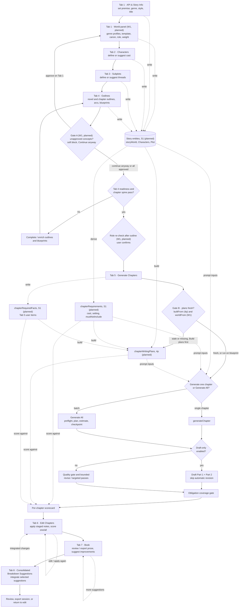
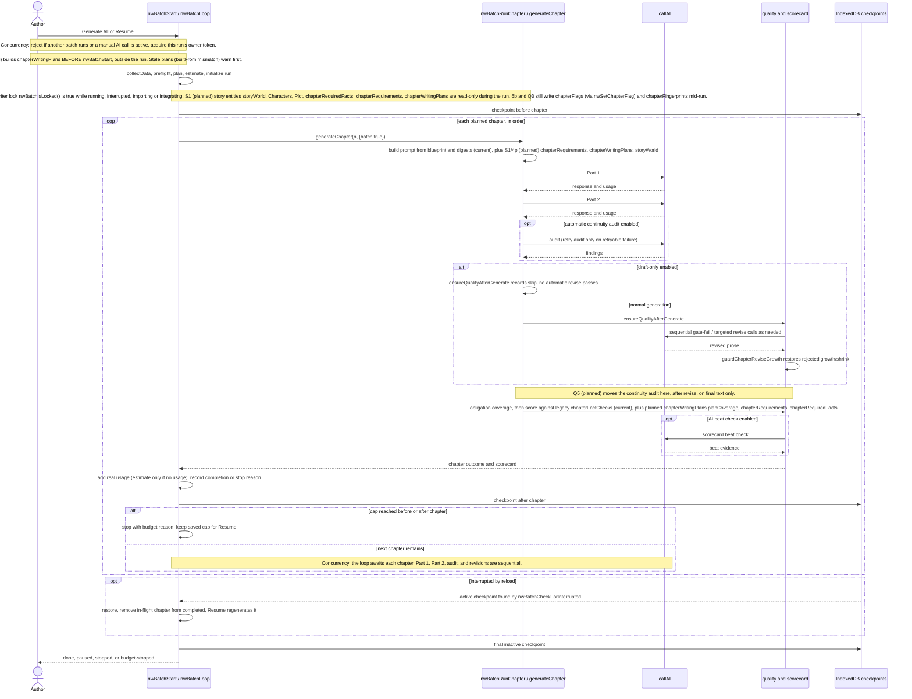
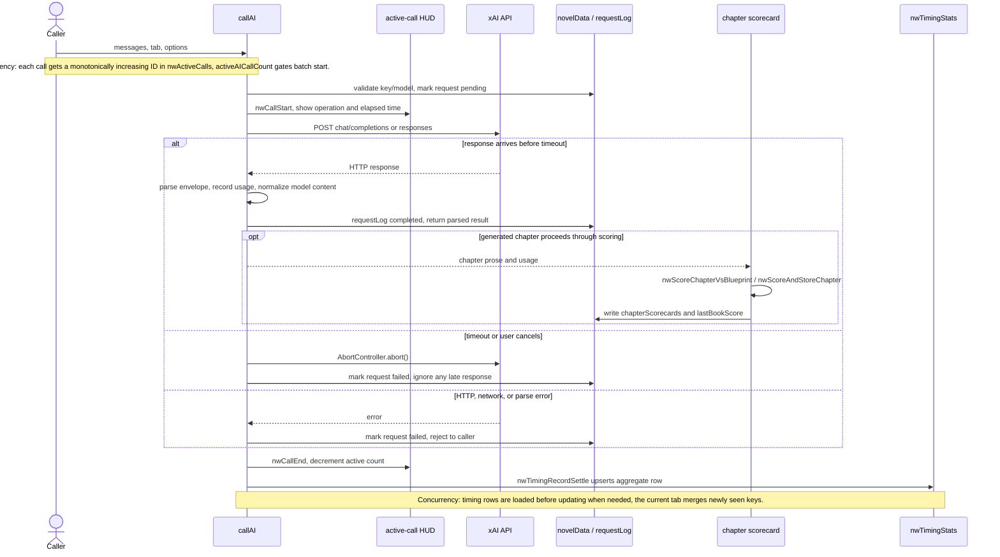
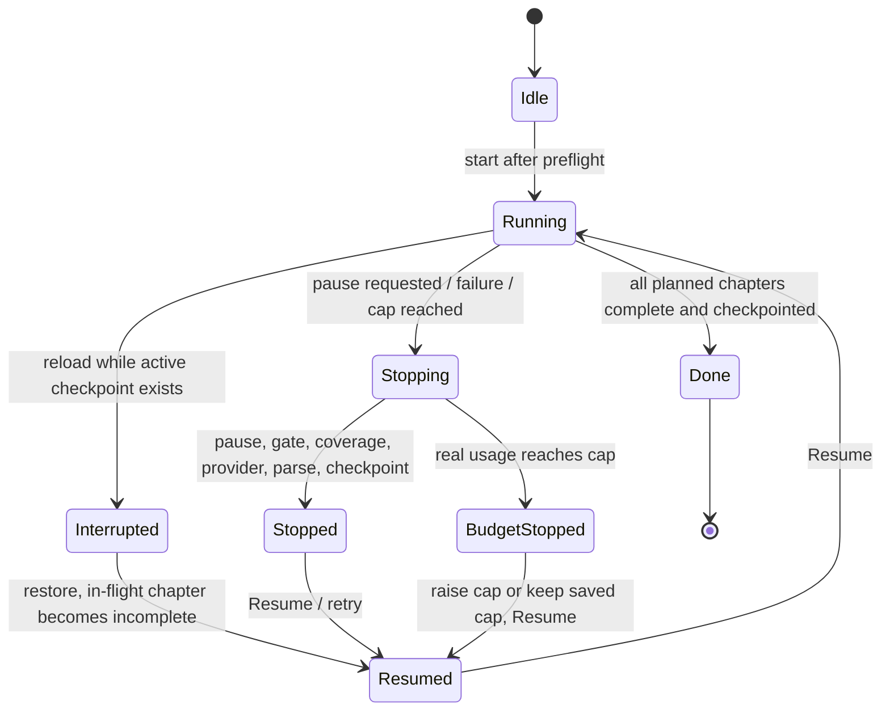
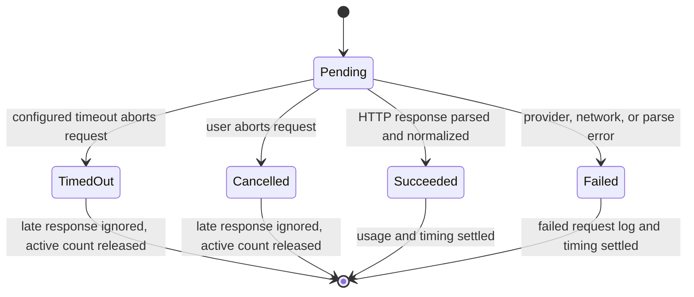
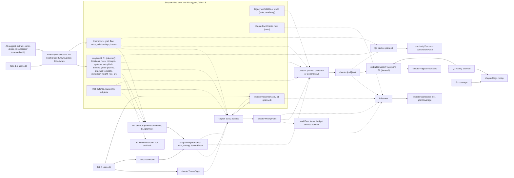
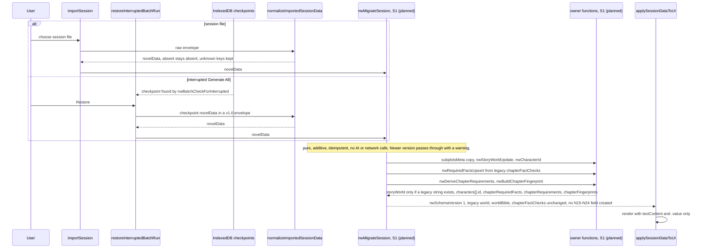

# NovelWriter architecture

NovelWriter is a single-page application in `NovelWriter.html`. The UI, shared
book state, workflow logic, and AI gateway are in that file; session files and
IndexedDB checkpoints provide the explicit persistence paths. Prose and tables
outside the "Data model and schema" section describe the code on main
(`34a2417`, 6b #154 merged). Diagram nodes, notes and messages labelled "S1 (planned)",
"4p (planned)" or "Q-slot (planned)" are the A1 design target, not current code.

## State and persistence

- **In memory:** `novelData` is the working book: story setup, characters,
  subplots, outlines and blueprints, chapter prose, continuity, quality and
  scorecard results, token usage, and batch progress. `requestLog` is the most
  recent request/response display. `collectData()` copies editable controls
  into `novelData`; chapter text is read from the Tab 5/6 editors
  (`NovelWriter.html:13680-13775`).
- **localStorage:** the app does not use `localStorage` to save or restore the
  book or API key. The key is held in the UI/in-memory state but is omitted from
  session exports and batch checkpoints. An old in-file testing comment about
  storing the key in localStorage is not the session persistence path
  (`NovelWriter.html:9597-9637`, `12549-12560`).
- **IndexedDB:** the `novelwriter` database / `checkpoints` store holds the
  latest resumable Generate All snapshot. It contains book data without the
  API key, and excludes the rejected draft that is retained only for session
  export (`NovelWriter.html:12510-12573`). A separate `novelwriter-timing` /
  `nwTimingStats` store holds aggregated per-call timing statistics
  (`NovelWriter.html:1230-1264`, `1295-1324`).
- **Session envelope:** `exportSession()` emits `schemaVersion: "1.0"`,
  `sourceTool`, `sourceVersion`, `exportedAt`, and `novelData` (including the
  request log), with timing data at the envelope's top-level `nwTiming` key
  (`NovelWriter.html:9597-9647`). `normalizeImportedSessionData()` accepts
  this envelope and legacy envelopes/bare data; `applySessionDataToUI()` then
  restores controls and views (`NovelWriter.html:9654-9761`,
  `9763-9857`). Imported timing data is shown for reference, not merged into
  the persistent timing statistics (`NovelWriter.html:9885-9890`).

## End-to-end tabs

The numbered workflow below is the primary authoring path. Tabs 10 and 11 are
debug and prompt-management utilities, outside this eight-tab path.

`generateChapter()` generates two prose parts and then runs continuity,
quality/revision (unless draft-only), obligation coverage, and the chapter
scorecard (`NovelWriter.html:11865-12064`). Tab 6's staged improvement path
uses `applyStagedChapterImprovements()` and can run a bounded targeted pass
after the edit (`NovelWriter.html:7746-7828`). Tab 7 presents the assembled
book and suggestions; Tab 8 integrates breakdowns into chapter planning and
prose (`populateConsolidatedBreakdowns()` at `NovelWriter.html:9069`,
`integrateBreakdownSuggestions()` at `NovelWriter.html:9149`).

`ensureQualityAfterGenerate()` runs the heuristic gate, then
`reviseChapterForQuality()` and `runTargetedQualityPass()` as needed; the
draft-only branch records that automatic passes were skipped
(`NovelWriter.html:7541-7677`, `7413-7457`, `7192-7276` respectively). The growth guard
rejects excessive growth, shrink, or lost paragraph structure and restores the
previous prose (`NovelWriter.html:7365-7409`). `scoreObligationCoverage()`
checks chapter blueprint obligations; `nwWorkflowStage()` derives the
book's progress label from its outlines, prose, and scorecards
(`NovelWriter.html:5662-5702`, `11681-11725`).

## Generate All: one chapter

Generate All runs chapters serially. It drafts prose for existing outlines; it
does not generate outlines. Preflight checks Tab 4 readiness and an 80-word
outline floor before any provider call (`NovelWriter.html:12486-12508`).
Existing prose is skipped unless regeneration is selected
(`NovelWriter.html:12472-12483`).

At run start, `nwBatchStart()` establishes a run owner and resets transient
batch flags/logs; a resumed run keeps its saved completed chapters, cap, and
usage (`NovelWriter.html:12840-13007`). `nwBatchEstimate()` uses mean real
session usage or a conservative fallback; `nwBatchRefreshEstimate()` refreshes
the displayed estimate and cap (`NovelWriter.html:12438-12450`,
`12656-12682`). `nwBatchLoop()` writes before/after chapter checkpoints,
charges actual provider usage when present, applies the cap, and classifies
stops (`NovelWriter.html:13010-13197`). A run also stops if a checkpoint write
fails. `nwBatchCheckForInterrupted()` offers restore; the in-flight chapter is
not marked complete and Resume retries it (`NovelWriter.html:13201-13264`).
Parse/provider stops regenerate the stopped chapter; a coverage stop is
acknowledged and skipped on the next Resume.

## One AI call

`callAI()` is the shared provider gateway. It selects the xAI endpoint by
model, sends the request, records returned token usage, parses/normalizes the
response, and returns it to its caller (`NovelWriter.html:2904-2916`,
`2957-3024`, `3032-3155`). HTTP/network errors set the request log to failed.
In a batch, a model JSON parse marker is treated as a parse stop by
`nwBatchRunChapter()` (`NovelWriter.html:12687-12734`).

`nwScoreChapterVsBlueprint()` calculates heuristic dimensions and can make a
separate AI beat-check call; `nwWriteChapterScorecard()` stores the chapter
record in `novelData`. `nwScoreBook()` awaits each requested chapter in order
and updates the book summary (`NovelWriter.html:11375-11429`,
`11431-11461`, `11470-11510`). Timing persistence is independent: successful
calls update average/min/max while timeout, abort, and error counters are
tracked separately (`NovelWriter.html:1295-1324`).

## Run and call states

`nwBatchState` tracks active ownership, chapter-in-flight, pause requests, and
an interrupted checkpoint; `novelData.batchRun` retains run id, range, completed
chapters, cap, usage, and stop reason (`NovelWriter.html:12106-12133`,
`12840-13007`). `nwBatchIsResumable()` excludes completed runs and uses the
stop reason to plan the retry (`NovelWriter.html:12577-12600`).

The call timeout defaults to 300 seconds and is configurable in Setup
(`NovelWriter.html:1090-1103`). The slow-step UI may continue waiting or cancel;
`callAI()` races the fetch with timeout/cancel and prevents an abandoned
response from recording usage or returning prose (`NovelWriter.html:2918-2933`,
`2971-3031`, `3157-3202`).

## Concurrency rules mapped to code

| Rule | Shared state | Enforced by (function, file:line on main) | Status |
|---|---|---|---|
| Single owner per shared state | Batch writes to `novelData`, batchRun, editors | `nwBatchStart()` run-owner token, `nwBatchIsLocked()`, `nwBatchApplyLock()` (`NovelWriter.html:12840-13007`, `12577-12626`) | GAP — the batch serializes its writers, but standalone AI actions can still overlap against shared `requestLog`/book state. |
| Per-call IDs | Active call HUD / call lifecycle | `nwCallStart()`, `nwCallEnd()`, `nwActiveCallSeq`, `nwActiveCalls` (`NovelWriter.html:1094-1155`) | OK |
| Per-run resets | Transient batch flags, logs, completion state | `nwBatchStart()` initializes new-run data and clears transient owner/pause/coverage/log state; resume preserves saved progress (`NovelWriter.html:12840-13007`) | OK |
| Merge-not-replace for persisted stats | In-memory timing aggregates hydrated from IndexedDB | `nwTimingLoadStats()` merges newly seen keys after load; `nwTimingRecordSettle()` updates and puts a keyed aggregate (`NovelWriter.html:1266-1291`, `1295-1324`) | GAP — separate tabs can update the same key from stale counts; IDB `put` is not a cross-tab read/merge transaction. |
| UI locked during a batch | Chapter controls, editors, import, scoring, and other writers | `nwBatchApplyLock()` disables the covered controls; guarded writers also check `nwBatchIsLocked()` (`NovelWriter.html:12577-12626`, `7679-7683`, `9860-9883`) | GAP — the list covers Tab 5/6 chapter controls, Tab 7 Apply, Tab 8 Integrate, import and batch/scoring controls only. AI actions and Setup inputs on Tabs 1-4 and Tab 7 stay enabled and do not check `nwBatchIsLocked()`, and `generateChapter()` re-reads Setup via `collectData()` each chapter, so a mid-run edit changes later prompts. |

## Validation harness

`scripts/qcat_harness.mjs` opens the single-file app in Playwright, blocks
network by default, imports a session, optionally stubs `callAI`, and invokes
`nwScoreBook()` to produce scorecard/session artifacts. Live regeneration is
opt-in and requires `QCAT_LIVE_ACK=1` (`scripts/qcat_harness.mjs:84-156`,
`159-168`, `221-255`). Its scoring logic remains in `NovelWriter.html`.

## Data model and schema (design only)

Status: DESIGN for A1, revision v9.3 (v9.3 adds Reviewer's #153 must-fix: clean-text / span-offset rule in §2b, fixture `v1-existing-core-ids-no-placeholders` in §4.4, ER label onstage/offstage. Earlier: revision v9.2 (v9.2 re-checks every as-built claim against main `34a2417` after 6b #154 merged, moves line refs to main, and folds in Fiction's N1-N4/S1 amendments: `origin:'import'`, session-level `ext.novelWriter.migratedBy:'S1'`, scene `onstage[]`/`offstage[]`, stored `bt_` beat ids. Earlier: revision v9.1 (v9.1 applies the CoS scene rulings (a)-(d), confirmed by Fiction: opaque `sc_`/`ch_` ids, `chapterIds`, core source enum, `breakApproved`, minimal required scene fields, plus the S1 merge acceptance in §4.5. Earlier: revision v9 (v9 adds scenes inside S1 per Brian's 11:09 PM CT ruling, no S1b, `nwSchemaVersion` stays 1, plus 6b's `batchRun.priorDrafts`. Earlier: revision v8 (v7 applied the CoS coherence rulings and Fiction's `builtFrom` inputs. v8 folds in Fiction's UI-plan amendment: `worldFrom`, scorecard shapes, `approvedAt` scope and the World panel and gates in the tabs flowchart. Earlier: revision v6 (v4 cleared Reviewer's NO-GO on `ee8a303`. v5 added the decided world-beat fields N15-N24, D1-D10 FINAL 2026-10-10, and Reviewer's v4 follow-ups 3 and 4. v6 clears Reviewer's v5 NO-GO: N20 points into the story ledger, and `normalizeCharacterItem` copies every present key). Engineering owns it. Product needs come from Fiction's `NW_STORY_SCHEMA_NEEDS.md` (written against main `600b35d`). No code changes in this PR. Slot S1 implements it, with a Reviewer GO on the migration trigger. Line numbers are against main `34a2417` (post-6b) and are approximate. The function names are the contract. Every function named here that is not on main is marked S1, 4p or a Q slot.

### 1. Where the data lives
- Everything is a **NovelWriter-local extension inside `novelData`**, carried in the existing shared v1.0 envelope. There are **no `schema/` or `docs/architecture/book-tools-contract/` changes**, so Nonfiction's confirm is not triggered. `novel-schema-1.0.json` allows extra properties on the envelope, `novelData` and `characters` items. Because `characters[]` is a shared-schema entity, the new `id`, `voice` and `relationships` fields will be visible to BookEditor and BookDecomposer, so Nonfiction gets an FYI (not a confirm).
- Promoting any entity (`storyWorld`, `characters[].voice/relationships`, a cross-tool `id` scheme) into the shared book schema is a **separate, later decision** needing Nonfiction's confirm and a Reviewer GO. `chapterFlags.coverageFailed/missing` and `chapterRequirements` must reference, not redefine, the ledger core (`CoverageReport`, obligations) once it lands.
- **Persistence (corrected in v4, matches "State and persistence" above):**
  - In memory: `novelData`.
  - Session file: `exportSession()` (~L9597) and `importSession()` (~L9860) through `normalizeImportedSessionData()` (~L9654).
  - IndexedDB `novelwriter` / `checkpoints`: `nwBatchCheckpoint()` (~L12550) stores the **full `novelData`** (API key deleted) for Generate All. `nwBatchFindInterrupted()` (~L12563) and `nwBatchCheckForInterrupted()` (~L13201) find an active checkpoint after reload, and `restoreInterruptedBatchRun()` (~L13213) replaces `novelData` with it. That path runs `normalizeImportedSessionData()` (~L13218) but **not** `importSession()`, so anything wired only into `importSession()` is skipped. After 6b the checkpoint also persists `batchRun.coverageAck {chapter, decision: accept\|skip\|regenerate, at, applied}` and `batchRun.suggestedCap`, and restore keeps them so Resume honours the decision. `applied:true` marks that the decision's side effects already ran; with `NW_6B_COVERAGE_ACK_APPLIED` on (default), `nwBatchApplySkipSideEffectsIfNeeded()` (~L12405) does not re-apply Skip (re-restore the prior draft) on Resume or restore. `batchRun.rejectedDraft` is **never** checkpointed. `batchRun.priorDrafts[n-1] = {text, at}` (6b re-gate) **is** saved in checkpoints and exports (§2). A coverage decision made mid-run (`nwBatchCoverageDecide`, ~L12747) saves an **active** checkpoint, so a reload offers Resume with that decision.
  - IndexedDB `novelwriter-timing` / `nwTimingStats`: timing aggregates only, never story data.
  - **localStorage holds no book data.** There is no `localStorage.setItem` on main, and there is no autosave. The only `localStorage` mentions are comments (~L13818, ~L13849, ~L14424, ~L14453).

### 2. Entities and owners per field
"Owner" is the only code path allowed to write the field. Slots (S1, 4p, Q1-Q5, 6b, 8d) say who builds the owner. Migration (§4) is never an owner. It writes only by calling the owner function.

| Entity / key | Field(s) | Owner (only writer) | Read-only consumers |
|---|---|---|---|
| **storyWorld** (new key, S1) | `storyWorld{version, notes?, locations[]?, rules[]?, concepts[]?, topicTags[]?}` plus the N15-N24 fields in §2a | `nwStoryWorldUpdate(patch, origin)` (S1), called by Tab 1-2 edits and AI-suggest. Enforces the canon lock (§2a) | 4p plan build, 8d, Q5, prompt binders only where they opt in (§3 rule 8) |
| Legacy world bible | `worldBible`, `world` (string or object) | **none in S1**: read-only inputs, kept byte-for-byte | existing `nd.worldBible \|\| nd.world` readers (~L1947, L2355, L4343, L4548, L4955, L5198, L5814, L6808, L10114, L10240), unchanged |
| Setting | `setting`, `genre` | Tab 1 `collectData()` (existing) | prompts, 4p, 8d |
| Plot | `storyArc`, `generalPlot`, outlines, `chapterOutlines[]`, `chapterArcs[]`, `chapterBlueprints[]`, `subplots[]` (strings) | user and AI-suggest in Tabs 1-4 (existing) | Generate All, 4p, 8d, Q1-Q3 |
| Subplot metadata (S1) | `subplotsMeta[i]` (same index as `subplots`) | `normalizeSubplotItem` copy step (S1) | 4p, Q5 |
| Character | `characters[]{id?, name, backstory, arc, role, goal, flaw, notes, obligations[], voice?, relationships[]?, explainerFor[]?, knows[]?}` | Tab 2 edit and AI-suggest, through `normalizeCharacterItem` only. `knows[]` only through `nwCharacterKnowsUpdate` (§2a) | prompts (bounded, §3 rule 8), 4p, 8d, Q5 |
| Character id | `characters[].id` | `nwCharacterId(name, taken)` (S1, §4.3), assigned only where absent | `chapterRequirements.cast`, 4p refs |
| Legacy plan facts | `chapterFactChecks[n-1]` (array of rows `{id,label,kind,match,pattern,beat?}`) | **existing writers, unchanged**: Tab 5 `nwCollectPlanFactsFromUi()` (~L11759) and harness `nwMergeQcatExpect()` (~L11328). See §7.1 | 8d `nwChapterFactEntries()` (~L10817), Tab 5 `nwRenderPlanFactsBox()` (~L11794) |
| Required facts (new key, S1) | `chapterRequiredFacts[n-1].items[]` | `nwRequiredFactsUpsert(n, items, source)` (S1). Each `source` value has one caller (§7.1) | Q1 prompt, 8d (from Q1), 4p `factId` |
| Requirements, derived | `chapterRequirements[n-1].cast`, `.setting`, `.derivedFrom` | `nwDeriveChapterRequirements(n)` (S1) | Q1, Q2 prompt, 8d cast and noteLeak |
| Requirements, user | `chapterRequirements[n-1].mustNotInclude` | Tab 5 user edit via `nwRequirementsSetMustNotInclude(n, list)` (S1) | same |
| Writing plan | `chapterWritingPlans[n-1]`, incl. `kind:'worldBeat'` items (N16, §2a) and `builtFrom` (hash of blueprint, requirements and required facts, §7.2) | 4p plan build or edit, **before** a batch starts. Read-only during a run. Rebuild is always a user action | 8d `planCoverage`, Generate All prompt |
| Plan world hash (W1) | `chapterWritingPlans[n-1].worldFrom` (string, `nwTextHash`, §7.2) | plan build (4p path with W1 inputs), beside `builtFrom` | Tab 5 stale banner, Generate All preflight (Gate B) |
| Theme tags (new key, S1) | `chapterThemeTags[n-1]` (N22, §2a) | `nwChapterThemeTagsUpdate(n, patch, origin)` (S1) | 4p, 8d (advisory, later) |
| Chapter id (new key, S1) | `chapterIds[n-1]` = `'ch_' + random` (§2b, §4.3 `nwOpaqueId`) | `nwChapterIdsUpdate(op, n)` (S1): assigns once where absent, and splices `chapterIds[]` in lockstep with `chapters[]` on every path that inserts, deletes, reorders or **resizes** chapters (resize pads with new `ch_` ids or truncates). **No other code may change `chapters[]` length without calling it.** Migration calls it (§4.2 step 4) | `chapterScenes[].scenes[].chapterId`, export |
| Scenes (new key, S1) | `chapterScenes[n-1]` (§2b) | `nwChapterScenesUpdate(n, patch, origin)` (S1), refuses while `nwBatchIsLocked()`. Migration calls it (§4.2 step 4) | 4p scene plan, 8d roll-up (advisory), Tab 5 scene panel |
| Prior drafts (6b) | `batchRun.priorDrafts[n-1] = {text, at}` (whole chapter text, chapter-keyed) | 6b helper family over `br = novelData.batchRun` (~L12330-12360): `nwBatchSetPriorDraft(br, n, text)` is **write-once** per chapter until cleared (`NW_6B_PRIOR_DRAFT_WRITE_ONCE`, default on; the oldest pre-run text wins), called from `nwBatchLoop()` on a coverage failure; `nwBatchClearPriorDraft(br, n)` nulls the slot; `nwBatchRestorePriorDraft(br, n)` writes it back as the chapter text and clears it. Skip restores it (via `nwBatchApplySkipSideEffects`); Skip with no prior keeps the failed draft and lists n in `batchRun.continuitySkip`. Accept clears it; a passing regenerate clears it (~L13078). Regenerate leaves it in place | Skip, Resume. Checkpointed (`nwBatchCheckpoint` keeps it; only `rejectedDraft` is dropped) and exported with `batchRun` |
| Coverage flags | `chapterFlags[n-1].coverageFailed`, `.missing`, `.at` | 6b, only through `nwSetChapterFlag(n, patch)` (sole writer, key merge). Clear-on-pass: a passing chapter merges `{coverageFailed:false, missing:[], at}` only when the existing flag has `coverageFailed === true` (`NW_6B_CLEAR_FLAG_ONLY_IF_FAILED`, default on), so a clean pass creates no entry | `nwRenderChapterFlag` (~L7319; Tab 5 `#chapterGenFlag{n}`, Tab 6 `#chapterEditFlag{n}`): coverage text only when `coverageFailed === true`, otherwise replay text when `replay` is set, else hidden. Resume |
| Replay flag | `chapterFlags[n-1].replay{…, at}` | Q3, only through `nwSetChapterFlag` | `nwRenderChapterFlag`, Resume |
| Fingerprint cache | `chapterFingerprints[n-1]` | `nwBuildChapterFingerprint(n)` (S1). Called by migration and by Q3 | Q3 replay check |
| Scorecards | `chapterScorecards[n-1]`, incl. three advisory keys, all out of `overall` until CoS promotes each: `planCoverage` (4p). `worldImmersion` = `{score, axes:{culture, science, tech}, beats:[…], method}`, shape owned by W1, `null` when there is no `storyWorld` or no worldBeats. `setupPayoff` = `{score, planted:{hit,total}, paid:{hit,total}, unpaid:[ids], abandoned:[ids], world:{…}, method:'heuristic'}`, shape owned by SC2, **always `null` until ledger L1** (SC2 never creates `storyLedger`). The "no ledger" reason is derived at render, not stored | 8d scorer (`nwWriteChapterScorecard`, existing) is the only writer. W1 and SC2 supply the compute functions | Tab 6, export |
| Continuity | `continuityTracker` | Q5 (final text only) | prompts. Per-chapter character state lives here and is **never duplicated** on Character |
| Version | `nwSchemaVersion` | `nwMigrateSession` stamp step and the new-session defaults (S1) | load paths |

v4 marked `concepts`, `topicTags`, `explainerFor` and `conceptId` as `[WAIT]`. Brian's decisions D1-D10 (FINAL 2026-10-10) resolve every one, so v5 drops the marker. They are designed in §2a.

### 2a. Story-world, canon and theme fields (N15-N24, decided)
All are **NovelWriter-local, optional and additive**. Absent stays absent, and a field is created only when an owner writes a value (no empty shells, no defaults). Product owner for all of them is **Fiction**. The code owner (only writer) is named per field. Readers type-guard and treat a wrong type as absent for that call (§3 rule 7). Every item array keyed by `id` merges by `id`. Unknown keys on an item, and on any nested object, are kept by every writer (shallow copy, then patch). Every `source` field in §2a uses the one enum `ai` or `user`. **Ids:** every new id'd item (concepts, rules, locations, systems, themes) gets `nwItemId(name, taken)`, the §4.3 `nwCharacterId` algorithm with de-dup scoped to its own array. `contradictions[].id` is `'ctr-' + nwTextHash(conceptId + '|' + text + '|' + (chapter ?? ''))`, because a contradiction has no name. **Top-level `themes`:** main already reads `novelData.motifs || novelData.themes` (~L6409). S1 **never writes a top-level `novelData.themes`**, only `storyWorld.themes`, and the L6351 reader does not read `storyWorld.themes` unless Q1 opts it in.

| N | Field and shape | Owner (only writer) | Readers | Merge rule |
|---|---|---|---|---|
| N15 | `storyWorld.genreProfiles[]` (profile ids, multi-select, blends allowed) | `nwStoryWorldUpdate` (Tab 1 picklist, AI-suggest) | 4p budget, 8d immersion weight default, N23 classifier | replace the whole array per edit. Legacy `genre` stays the single-select summary, owned by `collectData()`, never derived from or written by this |
| N15 | `storyWorld.structureTemplate{id, beats[{name, pct}]}`, `id` in `threeAct, saveTheCat, herosJourney, storyCircle, sevenPoint, kishotenketsu, custom` | `nwStoryWorldUpdate` | 4p beat placement | replace per edit. `pct` is 0-100 |
| N16 | `storyWorld.concepts[].mustExplain` (boolean), `.familiarity` (curve stage `new, introduced, familiar`) | `nwStoryWorldUpdate` | 4p budget | per-item key merge |
| N16 | worldBeat items in `chapterWritingPlans[n-1].items[]`: `{kind:'worldBeat', conceptId?, deliveryMode, via?, who?, where?}` with `deliveryMode` in `dialogue, action, interiority, artifact, staging, narration` | 4p (plan build or edit) | Generate All prompt, 8d `planCoverage` | 4p item rules. **The per-chapter budget is derived at plan build and never stored.** worldBeats live in the plan, never in `chapterBlueprints` |
| N17 | `locked` (boolean) and `source` (`ai` or `user`) on `storyWorld.concepts[]`, `.rules[]`, `.locations[]`, `.systems[]`, `.themes[]` and `characters[].knows[]` | the owning helper of each array (this table) | all editors, AI-suggest | see lock rules below |
| N17 | `storyWorld.concepts[].approvedAt` (ISO string) | `nwStoryWorldUpdate`, user approve action only | 4p (only approved concepts are used) | per-item key merge |
| N17 | `storyWorld.conceptsExtractedFrom` (`nwTextHash` of the extract inputs) | `nwStoryWorldUpdate`, called by the extract call `nwConceptsExtract()` (planned) | extract trigger | replace. A mismatch with the current source hash offers a re-run, never an automatic one |
| N17 | `storyWorld.contradictions[]{id, conceptId, text, chapter?, at}` | `nwStoryWorldUpdate`, called by the check call `nwCanonCheck()` (planned) | Tab 1-2 World editor, Tab 6 | append, de-duplicated by `id` (hash of `conceptId + text + chapter`). Cleared only by user dismiss, keyed by `id` |
| N18 | `storyWorld.immersionWeight{culture, science, tech}`, each a number 0-1 | `nwStoryWorldUpdate` (user, or AI-suggest from genre profiles) | 8d `worldImmersion` (when built) | per-axis key merge. 8d `worldImmersion` stays **null** until the scorer is built |
| N19 | `characters[].knows[]{conceptId, learnedIn, locked?, source?}`, `learnedIn` a chapter number | `nwCharacterKnowsUpdate(charId, entries, origin)` (S1), which writes through `normalizeCharacterItem` | 4p explainer choice, Q5 | merge by `conceptId`. D6 option C `chapterReveals` is **not** in v5 |
| N20 | **No setup store in the world layer.** Setup and payoff are owned by the story ledger (`/workspace/plans/NW_STORY_LEDGER_PLAN.md` L46, L151-189): `novelData.storyLedger.entries[]` with `kind:'setup'\|'payoff'`, its own status lifecycle (`planned, open, advanced, discharged, dropped`), `dischargeBy`, and the `nw_setup_unpaid` and `nw_payoff_before_setup` rules, built by `buildStoryLedgerFromPlan` (ledger L1-L3). The world layer adds only optional `storyWorld.setupRefs[]`: ledger entry ids (e.g. `setup-field-escape`), a pure reference with no status or text. **`storyLedger` defaults and creation are out of A1/S1 scope** (no default, no normalizer case, no migration step). The `setupRefs` editor is hidden or read-only until ledger L1, which gets its own later A1 amendment | `nwStoryWorldUpdate` (refs only) | 4p, 8d (read the ledger through the ref) | replace per user edit. A ref with no matching ledger entry is shown as unresolved and never repaired. The UI label 'abandoned (intentional)' goes on ledger status `dropped` (with `dropReason`). Replacing the ledger's setup and payoff kinds would be a CoS call and is **not** proposed |
| N21 | `storyWorld.systems[]{id, name, kind, hardness, powerSource, costs[], limits[], users[], ruleIds[], locked?, source?}`, `kind` `magic` or `tech`, `hardness` `hard` or `soft` | `nwStoryWorldUpdate` | 4p budget (hard systems raise the must-explain floor), Q2, Q5 | merge by `id`. `users[]` are character ids or text, `ruleIds[]` are `rules[].id` |
| N22 | `storyWorld.themes[]{id, text, locked?, source?}` | `nwStoryWorldUpdate` | 4p, 8d (advisory later) | merge by `id` |
| N22 | **new key** `chapterThemeTags[n-1]{tags[], source}` (theme ids or text) | `nwChapterThemeTagsUpdate(n, patch, origin)` (S1) | 4p, 8d (advisory later) | per-chapter object, `Object.assign` (§5). Separate from `chapterRequirements`, so that record's merge rule is unchanged. Sparse, never padded |
| N23 | `storyWorld.role{value, source, evidence[], decidedAt}`, `value` in `backdrop, rules, character`, `source` `ai` or `user` (the classifier writes `ai` and only proposes) | `nwStoryWorldUpdate`, called by the user or the classifier `nwClassifyWorldRole()` (planned) | 4p, N24 gate, 8d weight | replace. The classifier never overwrites `source:'user'`, it can only propose (D10 C: user confirms any change) |
| N24 | `storyWorld.arc[]{stage, chapterPos, change}` and `storyWorld.subplots[]{index, textHash}` (subplot index plus `nwTextHash(subplots[index])`, so no id has to be written into `subplotsMeta`, which stays owned by the normalizer copy step. A ref whose hash no longer matches is shown as stale. The ledger id is derivable as `subplot-<index+1>`) | `nwStoryWorldUpdate` | 4p plan items, 8d (advisory first) | replace per edit. **Written only while `role.value === 'character'`.** Readers ignore them otherwise |

**Canon lock (N17, D2).**
- `nwStoryWorldUpdate(patch, origin)` and `nwCharacterKnowsUpdate(..., origin)` take `origin` `user`, `ai` or `import`. `origin:'import'` is treated like `ai` for the lock (skips locked items; propose-only whole-replace fields are refused) and sets `source:'import'` on created items. With `origin:'ai'` they **skip every item whose stored `locked` is true**, matched by `id` (or `conceptId` for `knows`), and never delete an item. Skipped ids are returned so the suggest UI can show them.
- A `user` write may edit a locked item and may set or clear `locked`. Approving a concept sets `locked:true` and `approvedAt`. **`approvedAt` is on concepts only.** Approving a rule, location, system or theme sets `locked` (and `source`) only.
- `source` is set by the helper from `origin` (`user`, `ai` or `import`) when an item is created. A user edit of an `ai` item sets `source:'user'`.
- AI-suggest (D5) for every N15-N24 field goes through these helpers only, so suggestions are edited by the user before they are folded in.
- **Whole-replace fields are propose-only for AI.** `genreProfiles`, `structureTemplate`, `immersionWeight`, `arc` and `storyWorld.subplots` carry no per-item lock, so the helpers **refuse** an `origin:'ai'` write to them. AI-suggest shows a proposal and writes nothing. Only the user's accept writes it, with `origin:'user'`. `role` follows the same rule (a classifier result is a proposal, accepted by the user).

**AI-call budget.** One extract call (`nwConceptsExtract`) and one check call (`nwCanonCheck`) per book, plus D10's one small classifier call (`nwClassifyWorldRole`, at planning and once after outline). Each is counted in the run estimate (the per-call usage log) and the ledger before it merges, not in `nwBatchEstimate`, which is batch-only. None runs during migration or during a batch. Re-runs are user-triggered only, when `conceptsExtractedFrom` no longer matches the source hash.

**Batch lock.** Every new editor and suggest control (genre profile picklist, structure template, concept, location, rule, system, setup, theme and contradiction editors, immersion weight, world role and arc, character knowledge, chapter theme tags) joins the `nwBatchApplyLock()` list, and each helper above refuses to write while `nwBatchIsLocked()` is true (§5).

### 2b. Scenes inside chapters (Brian 11:09 PM CT, decision 11, inside S1; planned, not on main)
**Status: planned (S1).** None of `chapterScenes`, `chapterIds`, `nwChapterScenesUpdate`, `nwChapterIdsUpdate` or `nwOpaqueId` exists on main `34a2417`. Scenes are first-class sub-units of a chapter, bounded by a change of location or of character interaction. Product owner is **Fiction**. Source: `STORY_SCHEMA_CONVERGENCE_PLAN.md` §6a (v2.2) and the scenes addendum of `NW_SLOT_S1_SCHEMA_SPEC.md`.

| Field and shape | Owner (only writer) | Readers | Rules |
|---|---|---|---|
| `chapterScenes[n-1] = {version, textHash, scenes:[{id, chapterId, order, breakApproved, source?, boundaryReasons[]?, span?{start,end}, pov?, locationId?, time?, onstage[]?, offstage[]?, goal?, conflict?, outcome?}]}` (field names match core Scene; no `cast`, no per-scene `migratedBy`). **Required in core:** `id`, `chapterId`, `order`, `breakApproved` only | `nwChapterScenesUpdate(n, patch, origin)` (S1). Refuses while `nwBatchIsLocked()`. Merges scenes by `id` and keeps unknown keys. Added to `_nwSmokeSnapshot` | 4p (scene plan), 8d (roll-up, advisory), Tab 5 | Sparse, lazily created. Chapters without text get no entry |

- **Stable ids (CoS ruling a):** scene `id = 'sc_' + random` (`nwOpaqueId('sc_', taken)`, §4.3), opaque and assigned **once** at creation, never derived from position, title or text, never re-derived. `chapterId` holds the chapter's stable `chapterIds[n-1]` (`'ch_' + random`, assigned once by S1). `order` is the scene's position within the chapter and is stored separately from the id; the chapter's position is its array index, also separate. Renames, chapter insert, delete, reorder and resize (via `nwChapterIdsUpdate`), and scene reorder keep every id. Resize of the chapter count pads `chapterIds[]` with new ids or truncates it in lockstep with `chapters[]`.
- **Optional fields (CoS ruling c):** `goal`, `conflict` and `outcome` are optional in core. BookDecomposer may require them for approved scenes in its own checks; NovelWriter never schema-requires them.
- **Dangling refs:** any `sceneId` (blueprint beat, plan item, `chapterFlags[n-1].missing[]` entry, scorecard breakdown) that no longer resolves falls back to **chapter scope**. It is never dropped or repaired.
- **Provenance (CoS ruling b):** scene `source` uses only the core enum `ai`, `user` or `import`. Scenes created by S1 migration are `source:'import'`, `breakApproved:false` and have no `span`; that is how a placeholder is recognised. Migration provenance lives in exactly one place, session-level `ext.novelWriter.migratedBy:'S1'`, stamped once by migration. No scene, chapter or other object carries `migratedBy`, internally or in export.
- **Approval (CoS ruling d):** **Effectively approved** (per Fiction) = `breakApproved === true` **and** the stored `chapterScenes[n-1].textHash` equals the current `nwTextHash` of the chapter text. Only effectively-approved scenes are authoritative. `builtFrom` and every staleness check use this test, never the raw `breakApproved` flag, so a hash-mismatched scene counts as unapproved immediately, before any save persists `breakApproved:false`. No reader treats any other scene as a rule. **Export:** unapproved placeholder or implicit scenes are exported with `breakApproved:false` and their `source`. Receivers treat them as unapproved, never locked and never authoritative.
- **Clean text (S1 / N1-N4 rule 10):** stored chapter text is always clean, with no scene markers. Scene boundaries are character offsets (`span`) into that clean text only, and `textHash` covers the clean text. `chapters[n-1]` always holds the clean text; N4 parses scene markers out of the draft-call response and removes them before the text is stored or hashed, so markers never reach fingerprints, export, 8d or the QCAT pin.
- **span** is a character-offset range into the **clean** chapter text, valid only for the stored `textHash`. When the chapter's `nwTextHash` differs from `textHash`, every span in that chapter is stale. Spans are **never auto-shifted**. The UI shows those boundaries as proposed again (`breakApproved:false` on the user's next save through the helper, reason `chapter text changed`). No span means the whole chapter.
- **Chapter keying stays:** `chapterBlueprints` beats, `chapterWritingPlans` (S1 reserves `scenes[]` and `items[].sceneId?`, 4p fills them), `chapterFlags`, `batchRun.priorDrafts` and `chapterScorecards` (optional `scenes[{sceneId, planCoverage}]` from 8d) stay keyed by chapter, with an optional `sceneId` only. `knows[].learnedIn` stays a chapter. `learnedInScene` is not in S1.
- **Batch lock:** the scene editor joins the `nwBatchApplyLock()` list (§5).

### 3. Preservation rules (the #141 lesson)
1. **Absent stays absent.** Import, restore, tab rebuild and save never write a default into a field the session didn't have. Exceptions are only the **existing** coercions on main, listed so S1 doesn't add more: `normalizeImportedSessionData` (~L9687-9721) coerces non-arrays to `[]` for `authors, characters, subplots, chapterOutlines, chapterArcs, chapters, editedChapters, bookImprovements, bookImprovementsWithStatus, chapterImprovements, chapterScorecards, chapterFactChecks, workflowLog, chapterContinuityPackets, continuityFindings` and fills `factChecks` and `continuityTracker` shells. `updateChapterSubpages()` (~L4739) pads the per-chapter arrays it already pads. **No new S1 key is padded or coerced.**
2. **Unknown keys survive.** The normalizer only adds or validates known keys and never rebuilds `novelData` from a whitelist.
   - **`chapterFlags` (after 6b):** the import and restore normalizer (`NW_6B_FLAGS_PASSTHROUGH`, ~L9725-9750) passes each object entry through as a shallow copy with every key kept; absent stays absent; a non-array `chapterFlags` is kept as-is with a console warning; a non-object **entry** inside the array becomes `null` silently. It is not in the defaults and is never padded; `updateChapterSubpages()` only truncates it when it is longer than `numChapters`. `nwSetChapterFlag` creates an entry **lazily on first write** only, with no `null` padding and no fixed-key rebuild. `missing` is a copy of the CoverageReport misses (a reference, not a redefinition). A scene-level miss is a `missing[]` entry carrying `sceneId`. There is no scene-keyed flag store. **Null gaps:** a sparse `chapterFlags` array exports as JSON with `null` at untouched indexes. Every reader treats `null` as absent, and the normalizer keeps the `null` as-is (it does not count as a wrong type).
3. **One normalizer per entity**, used by import, restore, DOM rebuild and AI-suggest alike. S1 routes the Tab 2 rebuild (~L4081) through `normalizeCharacterItem` (~L2217).
4. **`normalizeCharacterItem` must be extended so absent stays absent.** Today it invents `obligations: []`, `backstory: ''`, `arc: ''` (~L2220-2230) and drops items with no name, backstory or arc. S1 changes it to **copy every key present on the input, unknown keys included** (a shallow copy, then type-check of known keys), with **no keep-list**. It only validates or normalizes known keys (`name, backstory, arc, role, goal, flaw, notes, obligations, id, voice, relationships, explainerFor, knows`) and never writes a default for an absent key. `knows[]` and its per-entry `locked`/`source` therefore survive every Tab 2 rebuild. It keeps the drop rule. Callers that need a default apply it at read time.
5. **Subplots:** `normalizeSubplotItem` (~L2234) keeps flattening to the string array for compatibility, but **first** copies object fields to `subplotsMeta[i]`.
6. **World:** `worldBible` and `world` are never written by S1. Their existing readers keep working unchanged and never see `storyWorld`. Migration creates `storyWorld` only when it is absent **and** there is a string legacy value to carry, copying it into `storyWorld.notes` (`worldBible` first, else `world`). Otherwise `storyWorld` stays absent until a user edit or an AI-suggest write creates it. An object legacy `world` is not mapped. It stays the bible for existing readers. Inside `storyWorld`, the normalizer and `nwStoryWorldUpdate` keep unknown keys at every level, including nested objects such as `role`, `immersionWeight` and items of `systems[]`.
7. **Type handling.** For the new S1 keys (`storyWorld, subplotsMeta, chapterFlags, chapterWritingPlans, chapterRequirements, chapterRequiredFacts, chapterFingerprints, chapterThemeTags, chapterScenes, chapterIds, nwSchemaVersion`), `normalizeImportedSessionData` validates type, keeps absent as absent, and keeps a wrong type **as-is with a console warning**, never dropping or coercing it. Every S1 reader type-guards and treats a wrong-type value as absent for that call. Legacy keys keep the existing coercions from rule 1, unchanged.
8. **Prompts stay bounded.** `normalizeCharacterItem` also feeds `normalizeOutbound` (~L2338) and so every LLM payload. Extending stored fields must not grow prompts: `digestCharacters` (~L4958, capped at 24 entries) and the `normalizeOutbound` payload include a new field only when the prompt builder opts in for that stage. The existing `assertNoFullManuscriptDump` smoke budget (`digestCharactersChars < 2000`, ~L5945) must still pass on the rich fixture after S1.

### 4. Versioning and migration
#### 4.1 Version and entry points
- New `novelData.nwSchemaVersion` (integer). **Absent means legacy (0).** It **stays 1 in v5**: N15-N24 are optional, additive and new in S1 (no shipped build ever wrote v1), so they are part of the v1 definition and need no migration step. **Any future migration step that creates an N15-N24 field bumps `nwSchemaVersion` to 2.** S1 sets it to `1` in the defaults (~L732) and in `resetState()` (~L13786).
- `nwMigrateSession(nd)` (S1) **runs on every full load and is a no-op at the current version.** It is pure (no DOM, no network, **no AI calls**), **additive**, and **idempotent**: `migrate(migrate(x))` deep-equals `migrate(x)`. It never deletes or renames a key. A version newer than the app knows is loaded read-through, unchanged, with a console warning and a status-line note.
- Every path that installs a full `novelData` calls it after normalize and before `applySessionDataToUI`:
  1. `importSession()` (~L9887-9892): after `normalizeImportedSessionData`, before `novelData = importedNovelData`.
  2. `restoreInterruptedBatchRun()` (~L13218): after `normalizeImportedSessionData` on the checkpoint copy, before `applySessionDataToUI()`. A pre-S1 checkpoint is therefore migrated like a pre-S1 file.
  3. `resetState()` (~L13786) and the defaults (~L732) build a fresh v1 object, so they need no migration.
  - Not a load path: `_nwSmokeSnapshot` restore (`Object.assign(novelData, saved)`, ~L5948) puts back the same in-memory object a smoke test borrowed.
- Checkpoint restore replaces the whole of `novelData`. This is intentional: the checkpoint is the book. Merge-not-replace (§5) governs writes to a loaded session, not the load itself. Restore is only offered when no run is active, and `nwBatchApplyLock()` keeps the UI locked until restore or discard.
- **Writer lock states (6b):** `nwBatchIsLocked()` is true while the batch is **running**, **interrupted** (a checkpoint awaits restore or discard), **importing** or **integrating** (Tab 8). Import and Integrate are lock holders, so S1's migration on the import path runs inside the import lock.

#### 4.2 v0 to v1 steps (in order, each calls the owner function)
1. Copy subplot objects to `subplotsMeta` (normalizer copy step).
2. `storyWorld`: only if absent **and** `worldBible` (else `world`) is a string, create `{version:1, notes}` via `nwStoryWorldUpdate`. No empty `locations`, `rules` or other arrays. With no legacy string, `storyWorld` stays absent. Legacy keys untouched.
3. `characters[].id`: `nwCharacterId` only where `id` is absent.
4. `chapterScenes[n-1]`: for each chapter **with text** and **no existing entry**, first ensure `chapterIds[n-1]` via `nwChapterIdsUpdate('assign', n)` (every chapter, with or without text, only where absent), then call `nwChapterScenesUpdate(n, {version:1, textHash, scenes:[one scene]}, 'import')`: id `nwOpaqueId('sc_', taken)`, `chapterId: chapterIds[n-1]`, `order:1`, `breakApproved:false`, `source:'import'`, `boundaryReasons:[]`, **no span** (whole chapter), shown as "proposed, split or confirm". A placeholder, not a rule that chapter = scene. Chapters without text get no entry. Never overwrites an existing entry, so re-running is a no-op. Part of the single v0-to-v1 migration, so `nwSchemaVersion` stays 1. Migration then stamps session-level `ext.novelWriter.migratedBy:'S1'` once (never on a scene).
5. `chapterRequiredFacts[n-1]`: **only for chapters that have no entry** (a present entry, of any type, is never touched) and where legacy `chapterFactChecks[n-1]` is a non-empty array or string, call `nwRequiredFactsUpsert(n, nwRequiredFactsFromLegacy(n), 'user')` (mapping in §7.1). Legacy untouched.
6. `chapterRequirements[n-1]`: `nwDeriveChapterRequirements(n)` for every chapter that has a blueprint. Names that don't resolve stay as text. It never touches `mustNotInclude`.
7. `chapterFingerprints[n-1]`: `nwBuildChapterFingerprint(n)` for every chapter with saved text.
8. **Create none of the N15-N24 fields** (§2a) and leave any that are present untouched, including `chapterThemeTags`. **Never create a `chapterFlags` entry**: flags come only from 6b and Q3 at run time.
9. Stamp `nwSchemaVersion = 1` last.

Export always writes the current `nwSchemaVersion`. Older builds keep the new keys through the existing spread, and their only coercion of a key S1 touches is legacy `chapterFactChecks`, which S1 never changes shape.

#### 4.3 Algorithms (pure JS, no crypto API)
- **Text hash `nwTextHash(s)`:** normalize with `String(s).replace(/\s+/g, ' ').trim()`, then FNV-1a 32-bit over the UTF-16 code units (offset basis `0x811c9dc5`, prime `0x01000193`, `Math.imul`, `>>> 0`), output as 8-char lowercase hex. One function serves `textHash`, `openingShingles`, `derivedFrom` and Q5 `auditedTextHash`.
- **Character id `nwCharacterId(name, taken)`:** `name.normalize('NFKD')`, strip combining marks (`/[\u0300-\u036f]/g`), lowercase, replace each run of non `[a-z0-9]` with `-`, trim leading and trailing `-`. An empty result becomes `char`. If the slug is already taken, append `-2`, `-3` and so on. Ids are assigned in `characters[]` array order, and existing ids are reserved first, so re-running never renumbers.
- **Opaque id `nwOpaqueId(prefix, taken, rng = Math.random)` (scenes, chapters, beats):** `prefix + ` 10 chars of lowercase base36 from `rng()` (no crypto API), regenerated on the rare collision with `taken` (all ids of that kind in the session). `rng` defaults to `Math.random`, so production and migration need no argument. S1 fixtures and smokes inject a seeded deterministic `rng`, so ids become exact and fixture `expected` values can be asserted exactly; the pattern `/^sc_[a-z0-9]{10}$/` (or `ch_`) stays as a fallback when a seed is not supplied. Called only when an id is absent, so existing ids are never touched and re-running migration assigns nothing new.
- **Beat ids (`bt_`, N1-N4):** every `chapterBlueprints[n-1]` beat and every `chapterWritingPlans[n-1].items` entry of `kind` beat/worldBeat carries a stored `id = nwOpaqueId('bt_', taken, rng)`, assigned once when absent and stored on the beat, never re-derived, so re-export does not churn `story.beats[].id`. Blueprint and plan objects stay in `ext.novelWriter`; migration assigns none (export or the owner assigns on first need).
- **Item id `nwItemId(name, taken)`:** the same algorithm, with de-dup scoped to the item's own array (`concepts`, `rules`, `locations`, `systems`, `themes`), and an empty slug becoming `item`. Applied only by the §2a helpers when an item without an `id` is created. Migration assigns none.
- **Fingerprint `nwBuildChapterFingerprint(n)`:** `{textHash, tailWindowWords:250, openingShingles}`. `textHash` is over the chapter's saved text. `openingShingles` are `nwTextHash` of each 8-word window over the first 200 words, step 4 (at most 49 entries). It holds no text. Skip when the stored `textHash` already matches.
- **Requirements freshness:** `chapterRequirements[n-1].derivedFrom = nwTextHash(JSON.stringify(chapterBlueprints[n-1]))`. There is **no timestamp**. A re-derive is skipped when `derivedFrom` matches, so migration is deterministic.

#### 4.4 S1 fixtures (N6)
Path: `NovelWriter/fixtures/nw-migration/<case>.json` (beside the existing `NovelWriter/fixtures/rich-scifi-v1/`), each `{input, expectedAddedKeys, expectedWarnings, notes}`. Smoke: `scripts/_smoke_nw_migration.mjs`. For each fixture: `migrate(input)` equals `input` plus exactly `expectedAddedKeys` (JSON paths), every pre-existing key deep-equals its input, `migrate(migrate(x))` deep-equals `migrate(x)`, and export-then-import round-trips deep-equal. The **mutation check**: for each fixture, the smoke deletes in turn every top-level key and every key of `characters[0]` from a migrated copy, re-runs the comparison, and must fail each time. **Scorecard must not move:** the 8d calibration fixtures ("must match pre-slot exactly") are pinned **after** S1's migration, and the smoke asserts the 8d fact score is unchanged on migrated QCAT sessions.

| Case file | Input | expectedAddedKeys |
|---|---|---|
| `v0-pre6b-no-flags.json` | chapters and blueprints, no `chapterFlags` | `nwSchemaVersion`, `chapterRequirements[*]`, `chapterFingerprints[*]` (no `chapterFlags`) |
| `v0-worldbible-string.json` | string `worldBible` | `storyWorld` = `{version, notes}` only, version, derived records |
| `v0-world-string.json` | string legacy `world`, no `worldBible` | `storyWorld` (with `notes` from `world`), version |
| `v0-world-object.json` | object `world` copied from `rich-scifi-v1/novelData.seed.json` | version only. **No `storyWorld`** (v5). `world` byte-equal |
| `v0-no-world.json` | no `worldBible`, no `world`, no `storyWorld` | version, derived records. **No `storyWorld`** |
| `v0-characters-rich.json` | characters with `obligations, goal, flaw`, a duplicate name, a diacritic name | `characters[*].id` (e.g. `ana`, `ana-2`, `zoe`) |
| `v0-subplot-objects.json` | object subplots | `subplotsMeta[*]` |
| `v0-partial-writing-plans.json` | `chapterWritingPlans` for 2 of 4 chapters, one with an unknown field | version, derived records. Plans untouched, no padding |
| `v0-factchecks-legacy.json` | `chapterFactChecks` with row arrays (include, exclude, probe) and one string entry | `chapterRequiredFacts[*]`. Legacy byte-equal |
| `v0-cast-unresolved.json` | blueprint cast names with no matching character | `chapterRequirements[*].cast` with text entries |
| `v0-replay-preflags.json` | duplicated chapter text, no `chapterFlags` | `chapterFingerprints[*]`, no flag |
| `v0-checkpoint-restore.json` | an IndexedDB checkpoint record `{novelData, batchRun}` with v0 `novelData`, driven through `restoreInterruptedBatchRun()` | same as the import case. `batchRun` per main's restore rules |
| `v1-current.json` | output of a migrated fixture | none (idempotence) |
| `v2-newer-version.json` | `nwSchemaVersion: 2`, unknown keys | none, warning expected |
| `v1-wrong-types.json` | `storyWorld: "text"`, `chapterRequirements: {}`, `chapterRequiredFacts: 5`, `chapterIds` string, `chapterScenes` object | none; warnings; values kept as-is; migration skips the owner write for wrong-typed `chapterIds`/`chapterScenes` |
| `v0-required-facts-present.json` | legacy `chapterFactChecks` rows for ch1-2, and an existing `chapterRequiredFacts[0]` | `chapterRequiredFacts[1]` only. Entry `[0]` deep-equal |
| `v1-world-full.json` | `storyWorld` with every N15-N24 field (incl. `setupRefs`, no `setups`), `characters[].knows[]`, `chapterThemeTags`, worldBeat plan items | none. Every key deep-equal after migrate and round-trip |
| `v1-locked-canon.json` | locked and unlocked concepts, rules, locations, systems, themes and `knows` entries, driven through `nwStoryWorldUpdate` and `nwCharacterKnowsUpdate` with `origin:'ai'` patches for all of them | helper test, not migrate. Expected: locked items deep-equal, unlocked items patched, skipped ids returned, no item deleted |
| `v1-role-character.json` | `role.value:'character'` (`source:'user'`) with `arc[]` and `subplots[{index, textHash}]` | none. Then an `ai` patch to `role.value:'backdrop'` over `source:'user'` is refused, and a `user` downgrade keeps `arc`/`subplots` stored and readers ignore them |
| `v1-role-backdrop.json` | `role.value:'backdrop'`, an `arc` patch | helper refuses the write. `arc` stays absent |
| `v1-unknown-nested.json` | unknown keys on `storyWorld`, `role`, `immersionWeight`, `structureTemplate.beats[0]`, `systems[0]`, `knows[0]`, `chapterThemeTags[0]` | none. Every unknown key survives migrate, import, restore and one `nwStoryWorldUpdate` call |
| `v1-n-wrong-types.json` | `chapterThemeTags: "x"`, `storyWorld.systems: {}` | none, warnings, kept as-is, readers treat them as absent |
| `v1-knows-tab2-rebuild.json` | characters with `knows[]` (one locked, one with an unknown key) and an unknown character key, driven through the Tab 2 DOM rebuild and `normalizeCharacterItem` | helper test. `knows[]`, its `locked`/`source` and the unknown keys deep-equal after rebuild |
| `v1-ai-propose-only.json` | user-set `genreProfiles` and `immersionWeight`, then `origin:'ai'` patches to both | helper test. Both refused, values deep-equal, a proposal is returned. A following `origin:'user'` accept writes it |
| `v1-plan-stale.json` | 5 chapters with plans built from the current inputs, then: ch1 unchanged, ch2 blueprint edited, ch3 a `chapterRequiredFacts` item text edited, ch4 `mustNotInclude` edited, ch5 plan with no `builtFrom`. Also ch1 re-ordered required-facts items and a changed `derivedFrom` only | none. Stale check returns ch2-ch5, ch1 stays fresh (sort by id and `derivedFrom` exclusion), migration writes no `builtFrom`, and no rebuild is triggered |
| `v1-flags-passthrough.json` | sparse `chapterFlags` with an unknown key, `coverageFailed:false`, a `replay` object and a wrong-type entry | none. Every entry deep-equal after import and restore, no padding, one warning |
| `v1-plan-world-stale.json` | plans built with `worldFrom`, plus a pre-W1 plan with no worldBeat items and no `worldFrom`, and a plan with worldBeat items and no `worldFrom`. Then: lock an already-approved concept, approve a new used concept, accept a role change | helper test. Locking alone leaves every plan fresh. Approve and role accept make the affected plans stale with `builtFrom` unchanged. The pre-W1 plan without worldBeats stays fresh, and the worldBeat plan without `worldFrom` is stale |
| `v0-chapters-to-proposed-scenes.json` | 3 chapters, 2 with text | `nwSchemaVersion` 1, `chapterScenes[0]`, `chapterScenes[1]`, each one scene with no `span`, `breakApproved:false`, `source:'import'`, no scene-level `migratedBy` key, session-level `ext.novelWriter.migratedBy === 'S1'` (only occurrence), `id` equal to the seeded `nwOpaqueId` value (exact assert; pattern `/^sc_[a-z0-9]{10}$/` is the fallback), `chapterId` equal to `chapterIds[n-1]`. `chapterIds[0..2]` all set to the seeded `ch_` values (exact; pattern fallback `/^ch_[a-z0-9]{10}$/`), including the chapter with no text. A plan's `builtFrom` is unchanged. Rerun is a no-op (ids unchanged) |
| `v1-no-text-no-scenes.json` | chapters with no text | `chapterIds` assigned. No `chapterScenes` |
| `v1-existing-core-ids-no-placeholders.json` | chapters with preset `chapterIds` and `chapterScenes` (including scenes already mapped from core) | none. No new `ch_`/`sc_` ids minted, no placeholder scenes added. Existing entries deep-equal after migrate and round-trip |
| `v1-scenes-approved-untouched.json` | an existing approved `chapterScenes` entry with an unknown key | none. Entry deep-equal after migrate and round-trip |
| `v1-text-hash-change-reproposes.json` | approved scenes with spans, a plan built with them, then the chapter text edited (no save) | helper test. Before any save: the scenes are not effectively approved, the plan is **stale** (its `builtFrom` no longer matches), spans are stale with offsets unchanged (no auto-shift), boundaries shown as proposed with reason `chapter text changed`, stored `breakApproved` still `true`. After the next user save: `breakApproved:false` persisted, plan still stale |
| `v1-ids-survive-insert-reorder.json` | migrated session with 3 chapters and scenes, then insert a chapter at position 1, reorder chapters 2 and 3, delete one chapter, and reorder scenes inside one chapter | helper test. Every surviving `chapterIds` value and scene `id` is unchanged and moved with its chapter (deleted chapter's id and its scenes are gone), each scene's `chapterId` still resolves to its own chapter, only the new chapter gets a new seeded `ch_` id (exact assert), and only `order` and array positions change. Every path goes through `nwChapterIdsUpdate` |
| `v1-ids-resize.json` | migrated session with 3 chapters, then resize the chapter count up (to 5) and down (to 2) | helper test. Grow pads `chapterIds[]` with new seeded `ch_` ids; shrink truncates every S1 per-chapter array (`chapterIds`, `chapterScenes`, `chapterRequiredFacts`, `chapterRequirements`, `chapterFingerprints`, `chapterWritingPlans`). Shrink-then-grow must not restore a stale record. Surviving ids keep their values and positions |
| `v1-scene-core-minimal.json` | a scene with only `id, chapterId, order, breakApproved`, and an unapproved imported scene with `breakApproved:false` | none. Both load and round-trip. Export keeps `breakApproved:false`, and no reader treats the unapproved scene as locked or authoritative |
| `v1-dangling-sceneId-chapter-scope.json` | a plan item, a blueprint beat and a `missing[]` entry pointing at a deleted scene id | none. Each ref is kept unchanged and resolves to chapter scope |
| `v1-prior-drafts.json` | `batchRun.priorDrafts[1]` set, then a second write, then Skip, then Accept on another chapter | helper test. Second write refused (write-once). Skip restores the text. Accept clears it. Checkpoint and export keep it |
| `v1-flags-null-gaps.json` | `chapterFlags: [null, {coverageFailed:true}]` | none. `null` kept, read as absent, no warning |
| `v1-batch-locked.json` | `nwBatchIsLocked()` stubbed true, then one `user` write each to `nwStoryWorldUpdate`, `nwCharacterKnowsUpdate`, `nwChapterThemeTagsUpdate`, `nwChapterScenesUpdate` | helper test. All four refused, `novelData` deep-equal |

#### 4.5 S1 acceptance and merge checklist
- All §4.4 fixtures pass on the S1 head.
- **`nw-s1` fixture recheck at S1 merge:** the Step 0 `nw-s1` fixture created in S1 against A1 v9.3 is re-run against the S1 head before merge (seeded `nwOpaqueId` makes ids exact; the `sc_`/`ch_` patterns are the fallback, scene core fields, `source` enum, `breakApproved`). Expected values come from A1 v9.3 rules, not S1 output. Owner **Engineering**, checked by **Reviewer**. A mismatch blocks the merge.
- `setupPayoff` stays `null` until ledger L1 ships (§2 Scorecards row). S1 adds no `storyLedger`.

### 5. Write-concurrency rules
| Rule | Applies to | Enforcement (S1 or existing) |
|---|---|---|
| Single writer per field | §2 table | owner functions. Migration calls them and writes nothing directly |
| Story entities locked during a batch | storyWorld (incl. every N15-N24 editor in §2a), Plot, Character (incl. `knows`), required facts, mustNotInclude, chapter theme tags, scene edits and AI-suggest | `nwBatchIsLocked()` (true while running, interrupted, importing or integrating) plus the `nwBatchApplyLock()` list. S1 adds each new control to that list. REQ-SCH-11: a paused Generate All run keeps the #159 Setup lock held (`nwBatchSetupIsLocked()`) until the run ends or is cancelled; Resume stays enabled |
| Per-chapter records merge, never replace | `chapterFlags`, `chapterWritingPlans`, `chapterScorecards`, `chapterRequirements`, `chapterRequiredFacts`, `chapterThemeTags`, `chapterScenes` (all **objects** per chapter) | `Object.assign({}, existing, patch)` keyed by chapter index. Q3 and 6b share `chapterFlags[n-1]`. A re-derive of `chapterRequirements` replaces only `cast`, `setting`, `derivedFrom` and never touches `mustNotInclude`. `nwRequiredFactsUpsert(n, items, source)` replaces only items whose `source` equals its argument, matched by `id`, so user items survive a 4p or migration call |
| Legacy arrays keep main's semantics | `chapterFactChecks` (array per chapter) | not merged with `Object.assign`. Existing writers keep `concat` (harness) and replace-rows (Tab 5) |
| Await load before write | IndexedDB `nwTimingStats` | existing: `nwTimingLoadStats()` (~L1266) and the record path (8b) |
| Canon lock (N17) | `storyWorld` concepts, rules, locations, systems, themes and `characters[].knows` | `nwStoryWorldUpdate` and `nwCharacterKnowsUpdate` skip locked items for `origin:'ai'` and never delete (§2a) |
| Per-call / per-run identity | AI calls, Generate All runs | existing: per-call `nwActiveCalls` Map. Per-run reset of batch state |
| Migration runs on every load | import and checkpoint restore | `nwMigrateSession` between normalize and apply on both paths (§4.1) |
| **Safe in-app editing (N8)** | storyWorld and Character editors (and new Tab 5 fact or mustNotInclude rows) | Render user and AI text only via `textContent` and input `.value`. **No `innerHTML`, `insertAdjacentHTML` or `outerHTML` with story data.** Editors are disabled while `nwBatchIsLocked()` is true, and every save handler re-checks it. Scope is decided (D5): every N15-N24 field is user-editable, and every AI suggestion is editable before it is folded in |

### 6. Gaps on main that S1 must close
1. `worldBible`/`world` aren't in the `novelData` defaults (~L732) or the import normalizer, and only survive through the spread. S1 keeps that behavior for them (no defaults) and adds explicit handling for `storyWorld`.
2. The Tab 2 character DOM rebuild (~L4081) drops `obligations`, `goal` and `flaw`.
3. `normalizeCharacterItem` (~L2217) keeps only `name, backstory, arc, obligations` and writes defaults (§3 rule 4).
4. `normalizeSubplotItem` (~L2234) flattens objects to strings with no copy.
5. Checkpoint restore (`restoreInterruptedBatchRun`, ~L13213) has no migration hook (§4.1).

All are the same class of data loss as #141. S1 closes them before Q1-Q3 and 4p build on the schema.

### 7. Per-chapter requirement and replay records (N9-N14)
Engineering confirms the names `chapterRequirements` and `chapterFingerprints`. **N9 is renamed:** Fiction's `chapterFactChecks[n-1] = {items:[…]}` cannot work because main stores an array per chapter, so the new shape lives at **`chapterRequiredFacts[n-1]`** and legacy `chapterFactChecks` is left as is (Fiction informed in `fiction-notes-v4.md`). All keys are NovelWriter-local and indexed by `n-1`.

| Key | Shape | Owner (only writer) | Readers | Notes |
|---|---|---|---|---|
| `chapterRequiredFacts[n-1]` (N9) | `{items:[{id, text, mustInclude:boolean, source:'blueprint'\|'user'\|'plan', legacyId?}]}` | `nwRequiredFactsUpsert` (S1), per source: `user` = Tab 5 edit (Q1) and migration, `plan` = 4p, `blueprint` = `nwDeriveChapterRequirements` (Q1) | Q1 prompt, 8d (Q1 switches it on), 4p `factId` | Sparse: absent chapters stay absent |
| `chapterRequirements[n-1]` (N10, N11) | `{cast:[charId\|text], setting:[locationId\|text], mustNotInclude:[string], derivedFrom}` | `cast`, `setting`, `derivedFrom`: `nwDeriveChapterRequirements(n)` (S1), also used by 8d `cast`. `mustNotInclude`: Tab 5 user edit | Q1, Q2 prompt, 8d cast and noteLeak | Derived at migration and whenever `derivedFrom` is stale. `mustNotInclude` is merged with `NW_NOTE_LEAK_TERMS` at read time, never written into it |
| `chapterFlags[n-1].replay` (N12) | `{internal, prev, openingCopy, at}` (`at` inside `replay`) | Q3, through `nwSetChapterFlag(n, {replay})` | `nwRenderChapterFlag`, Resume | merges keys only (§5). **`replay` is the only name.** 6b's `replayFail` is renamed to `replay`. If any build still reads `replayFail`, it is legacy read-only and never written |
| `chapterFingerprints[n-1]` (N12) | `{textHash, tailWindowWords:250, openingShingles:[hash]}` | `nwBuildChapterFingerprint(n)` (S1), called by migration and Q3 | Q3 replay check | **A derived cache, never authoritative.** Holds hashes, not text. Rebuilt when `textHash` doesn't match, safe to drop |
| tracker row `auditedTextHash` (N13) | string (`nwTextHash`) | Q5 | Q5 | A mismatch marks the row stale. Q5 reads `storyWorld.rules` and `relationships` and never writes them |
| `chapterWritingPlans` item refs (N14) | optional `charId`, `locationId`, `factId` (a `chapterRequiredFacts` item id), `conceptId` (a `storyWorld.concepts[].id`) | 4p | 8d planCoverage | References only. A missing id keeps the item's `label` text |

#### 7.2 Plan freshness and precedence (CoS ruling)
- **`chapterWritingPlans[n-1].builtFrom`** = `nwTextHash` of a canonical join of three inputs, taken at build time: `JSON.stringify([chapterBlueprints[n-1], {cast, setting, mustNotInclude} of chapterRequirements[n-1] (derivedFrom excluded), chapterRequiredFacts[n-1].items mapped to {id, text, mustInclude} and sorted by id, the ids of effectively-approved scenes in chapterScenes[n-1] sorted])`. **Only effectively-approved scene ids** go in (§2b: `breakApproved === true` and stored `textHash` equals the current chapter hash, never the raw flag), so the migration's proposed scene does not make any plan stale. Approving, splitting or merging approved scenes does, and so does a chapter text edit that un-approves a scene in effect: plans that included it go stale at once, before any save. An absent input is written as `null` in its slot, and object keys are serialized in that fixed order. Only 4p writes `builtFrom`, on every plan build or rebuild. Migration never writes it.
- **`chapterWritingPlans[n-1].worldFrom`** (W1) = `nwTextHash(JSON.stringify([approvedConcepts, storyWorld.role.value, storyWorld.genreProfiles, storyWorld.structureTemplate.id, storyWorld.immersionWeight]))`. `approvedConcepts` = the `storyWorld.concepts[]` with `approvedAt` set that the plan build used, mapped to `{id, mustExplain, familiarity}` and sorted by `id`. **`locked` and `source` are not hash inputs**, so locking or unlocking an already-approved concept does not change `worldFrom`. An absent input is `null` in its slot, with fixed key order. Written only by the plan build (4p path, W1 inputs) on every build or rebuild, beside `builtFrom`. Migration never writes it. Optional, absent before W1.
- **Stale triggers:** a plan is **stale if `builtFrom` OR `worldFrom` mismatches** its current hash, with the current `builtFrom` always computed from effectively-approved scenes (§2b). `worldFrom` triggers: approving a concept, changing `mustExplain` or `familiarity` of a used concept, accepting a new `role`, and changing genre profiles, template or immersion weight. A plan **with** worldBeat items and no `worldFrom` is stale. A pre-W1 plan with **no** worldBeat items and no `worldFrom` is **not** stale on the world side. For `builtFrom`, when the current hash differs, the plan is stale. That happens on a blueprint change, a required-facts edit or a `mustNotInclude` edit alike (a re-derive of `cast`/`setting` that changes them counts too). Tab 5 and Generate All's pre-run step warn and offer a rebuild. A plan with no `builtFrom` (built before S1) is treated as stale. **Rebuild is always a user action.** It never happens automatically, and never during a batch (plans are read-only while `nwBatchIsLocked()`).
- **Precedence, stated once (agreed with Fiction): the blueprint outranks the writing plan.** The plan is derived from the blueprint. When they conflict, the user sees a warning, `builtFrom` marks the plan stale (also when required facts or `mustNotInclude` change after the build), and the prompt and 8d both follow the blueprint. The user decides when to rebuild.
- **Order:** 4p plans are built **before** a batch starts and are read-only during it. Q5 audits **after** revise, on final text only. Q3 writes through `nwSetChapterFlag`, with `at` inside `replay`.

#### 7.1 Legacy `chapterFactChecks` on main: every reader and writer
| Site (main) | Kind | S1 | Q1 |
|---|---|---|---|
| defaults `chapterFactChecks: []` (~L767), `resetState` (~L13804) | init | legacy, unchanged | unchanged |
| `updateChapterSubpages()` pad (~L4739) | writer (resize) | legacy, unchanged. Does **not** pad `chapterRequiredFacts` | unchanged |
| `_nwSmokeSnapshot` extra keys (~L6048) | snapshot | legacy, plus add `chapterRequiredFacts`, `chapterRequirements`, `chapterFingerprints`, `storyWorld` to the list | unchanged |
| `normalizeImportedSessionData` coercion (~L9704) | writer (coerce) | legacy, unchanged | unchanged |
| `nwEnsureScorecardArrays()` (~L10716) | writer (init) | legacy, unchanged | unchanged |
| `nwChapterFactEntries()` (~L10817), the 8d scorer input | reader | legacy only | also reads `chapterRequiredFacts` items, de-duplicated by `legacyId` |
| `nwMergeQcatExpect()` (~L11310-11328), qcat harness | writer (`concat`) | legacy, unchanged | stays legacy (harness expectations, not story data) |
| `nwCollectPlanFactsFromUi()` (~L11735-11760), Tab 5 plan-facts table | writer (replace rows) | legacy, unchanged | Tab 5 required-fact rows write `chapterRequiredFacts` via `nwRequiredFactsUpsert(...,'user')`. The legacy plan-facts table stays for probes |
| `nwRenderPlanFactsBox()` (~L11794) | reader | legacy, unchanged | unchanged, plus a new required-facts box |

`nwRequiredFactsFromLegacy(n)` (S1) maps legacy rows: `kind:'include'` gives `mustInclude:true`, `kind:'exclude'` gives `mustInclude:false`, and `kind:'probe'` is not mapped (probes stay legacy-only for 8d). `text = label || pattern`, `id = 'lf-' + (row.id || index)`, `legacyId = row.id`, `source:'user'`. A string entry becomes one `mustInclude:true` item with `id:'lf-0'`.

### 8. Schema diagrams
Entities and the derived per-chapter records. Everything here is **S1 (planned)** except the keys marked "main". N15-N24 entities are optional (§2a).

```mermaid
erDiagram
    NOVELDATA ||--o| STORYWORLD : "storyWorld, S1 (planned)"
    NOVELDATA ||--o| LEGACYWORLD : "worldBible or world, main, read-only"
    NOVELDATA ||--o{ CHARACTER : "characters[], main plus S1 fields"
    NOVELDATA ||--o{ SUBPLOT : "subplots[] main, subplotsMeta[] S1"
    NOVELDATA ||--o{ CHAPTER : "index n-1"
    STORYWORLD ||--o{ LOCATION : "locations[]"
    STORYWORLD ||--o{ RULE : "rules[]"
    STORYWORLD ||--o{ CONCEPT : "concepts[], N16 N17"
    STORYWORLD ||--o{ SYSTEM : "systems[], N21"
    STORYWORLD }o--o{ LEDGERENTRY : "setupRefs[] ids, N20"
    NOVELDATA ||--o| STORYLEDGER : "storyLedger, parked until ledger L1, not in S1"
    STORYLEDGER ||--o{ LEDGERENTRY : "entries[], kind setup or payoff, owns status"
    STORYWORLD ||--o{ THEME : "themes[], N22"
    STORYWORLD ||--o{ CONTRADICTION : "contradictions[], N17"
    STORYWORLD ||--o| GENREPROFILE : "genreProfiles[] and structureTemplate, N15, AI propose-only"
    STORYWORLD ||--o| IMMERSION : "immersionWeight, N18"
    STORYWORLD ||--o| WORLDROLE : "role, N23"
    STORYWORLD ||--o{ WORLDARC : "arc[] if role is character, N24"
    STORYWORLD }o--o{ SUBPLOT : "subplots[] index and textHash if role is character, N24"
    SYSTEM }o--o{ RULE : "ruleIds"
    SYSTEM }o--o{ CHARACTER : "users"
    CONTRADICTION }o--|| CONCEPT : "conceptId"
    CHARACTER ||--o{ KNOWS : "knows[], N19"
    KNOWS }o--|| CONCEPT : "conceptId"
    CHARACTER ||--o{ RELATIONSHIP : "relationships[]"
    CHAPTER ||--|| BLUEPRINT : "chapterBlueprints, main"
    CHAPTER ||--o{ LEGACYFACT : "chapterFactChecks rows, main"
    CHAPTER ||--o| REQUIREDFACTS : "chapterRequiredFacts, S1"
    CHAPTER ||--o| REQUIREMENTS : "chapterRequirements, S1"
    CHAPTER ||--o| WRITINGPLAN : "chapterWritingPlans, 4p"
    CHAPTER ||--o| FLAGS : "chapterFlags, 6b and Q3"
    CHAPTER ||--o{ SCENE : "chapterScenes scenes, scene chapterId is chapterIds entry, S1"
    SCENE }o--o| LOCATION : "locationId"
    SCENE }o--o{ CHARACTER : "onstage/offstage and pov"
    WRITINGPLAN }o--o| SCENE : "item sceneId, chapter scope if dangling"
    CHAPTER ||--o| FINGERPRINT : "chapterFingerprints cache, S1"
    CHAPTER ||--o| SCORECARD : "chapterScorecards, main"
    CHAPTER ||--o| THEMETAGS : "chapterThemeTags, N22"
    THEMETAGS }o--o{ THEME : "tags"
    WRITINGPLAN ||--o{ WORLDBEAT : "worldBeat items, N16"
    WORLDBEAT }o--o| CONCEPT : "conceptId"
    LEGACYFACT ||--o| REQUIREDFACTS : "migration seeds once"
    REQUIREMENTS }o--o{ CHARACTER : "cast charId"
    REQUIREMENTS }o--o{ LOCATION : "setting locationId"
    WRITINGPLAN }o--o{ CHARACTER : "item charId"
    WRITINGPLAN }o--o{ LOCATION : "item locationId"
    WRITINGPLAN }o--o{ REQUIREDFACTS : "item factId"
    WRITINGPLAN }o--o{ CONCEPT : "item conceptId"
```

How the entities feed the writing plan, the chapter prompt and the scorecard (solid arrows are writes by the owner, dotted arrows are reads):

Migration runs on every full load, from both entry paths, and is a no-op at the current version (all S1, planned):

### 9. N-mapping (needs to sections)
| Need | Where in this section |
|---|---|
| N1 location | §1 |
| N2 shared-schema confirm | §1 bullet 2 |
| N3 single owner | §2, §2a |
| N4 preservation | §3, §6 |
| N5 versioning | §4 |
| N6 fixtures | §4.4 |
| N7 concurrency | §5 |
| N8 safe editing | §5 last row |
| N9-N14 | §7, §7.1 |
| N15 genre profiles, structure template | §2a, §8 ER |
| N16 mustExplain, familiarity, worldBeat deliveryMode | §2a, §7 N14 row, §8 |
| N17 canon lock (incl. themes), extraction hash, contradictions, ids, propose-only | §2a (incl. canon lock and AI-call budget), §4.3 `nwItemId`, §5 canon-lock row, §4.4 `v1-locked-canon`, `v1-ai-propose-only`, `v1-batch-locked` |
| N18 immersion weight | §2a, §8 |
| N19 POV knowledge | §2 Character row, §2a, §3 rule 4, §4.4 `v1-knows-tab2-rebuild`, §8 ER |
| N20 setup and payoff (owned by the story ledger, refs only) | §2a N20 row, §8 ER |
| N21 system cards | §2a, §8 ER |
| N22 themes, chapterThemeTags | §2, §2a, §3 rule 7, §5, §8 |
| N23 world role | §2a, §4.4 `v1-role-*`, §8 |
| N24 world arc and subplots | §2a, §4.4 `v1-role-*`, §8 |
| Scenes (decision 11, CoS rulings a-d) | §2 Chapter id and Scenes rows, §2b, §4.3 `nwOpaqueId`, §4.5, §3 rule 7, §4.2 step 4, §4.4 scene fixtures, §5, §7.2 `builtFrom`, §8 ER |
| 6b priorDrafts, flag null gaps | §1 persistence, §2 Prior drafts row, §3 rule 2, §4.4 `v1-prior-drafts`, `v1-flags-null-gaps` |
