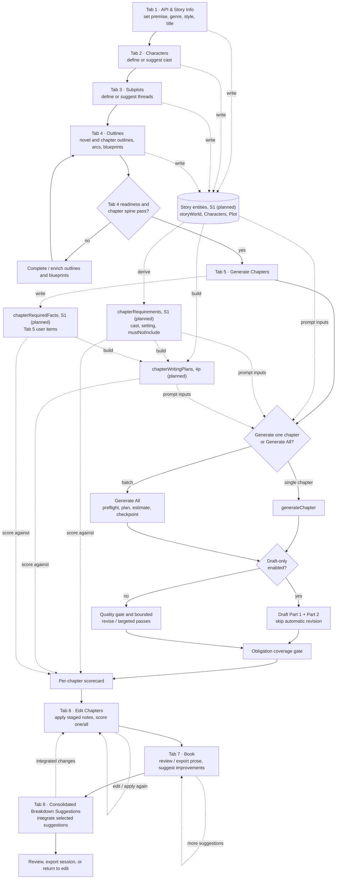
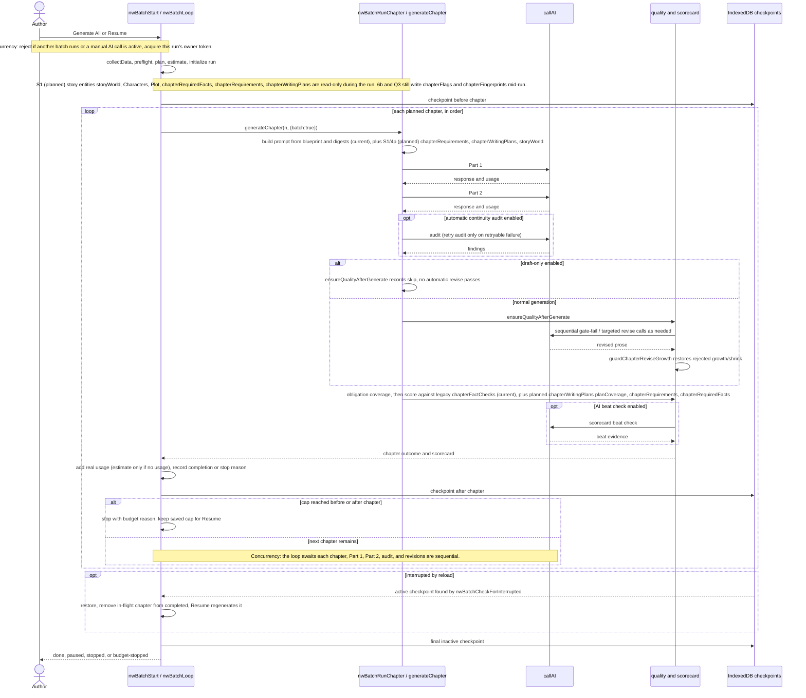
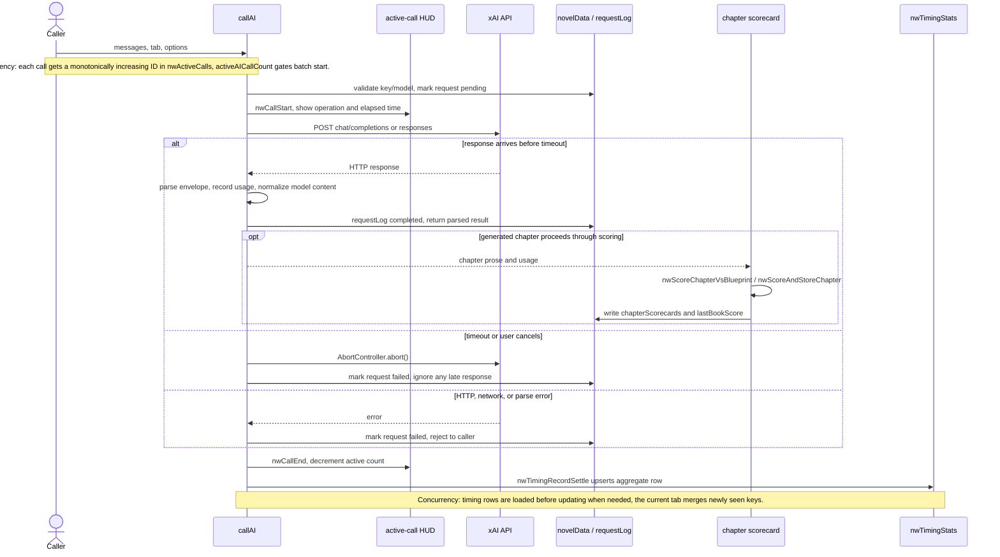
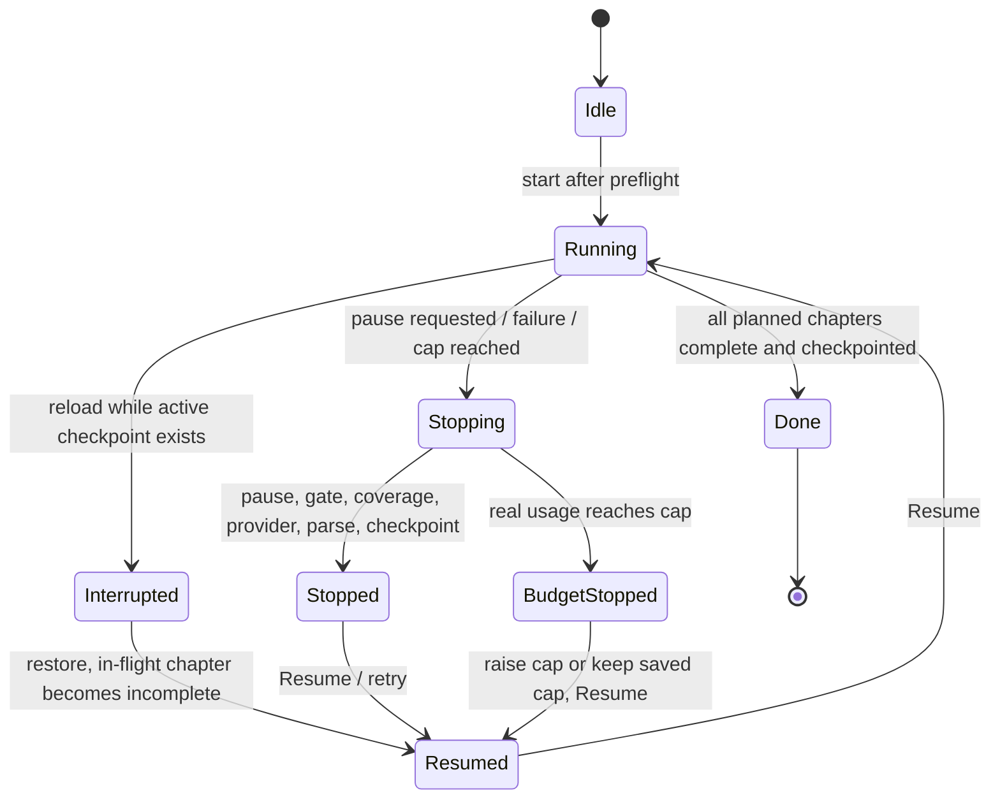
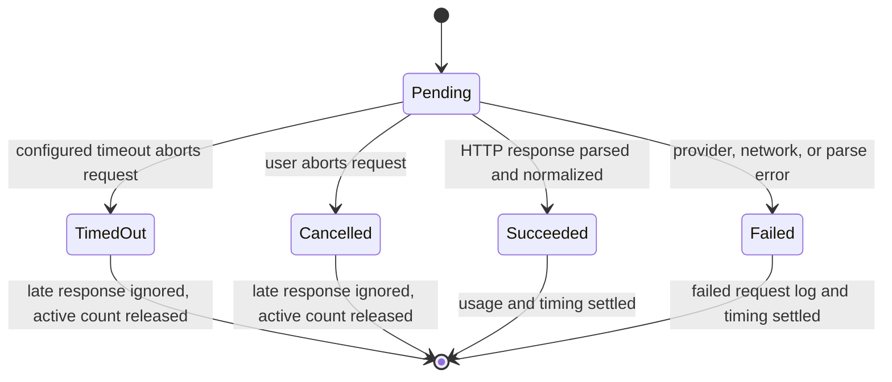
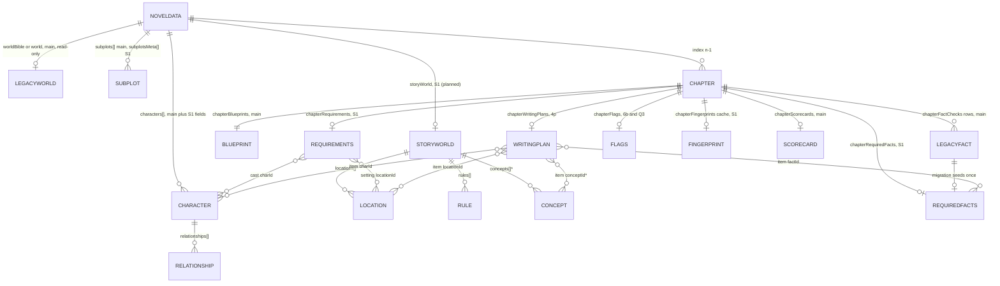
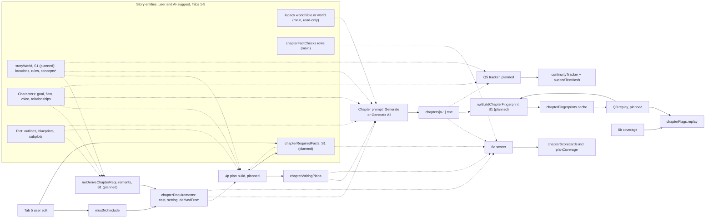
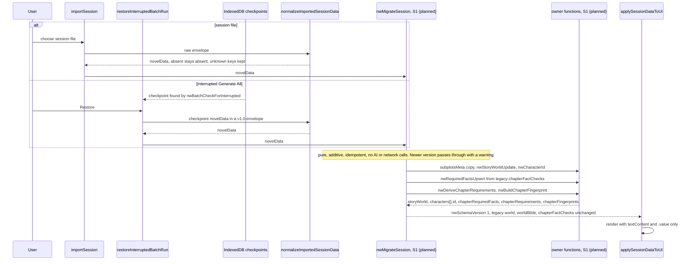

# NovelWriter architecture

NovelWriter is a single-page application in `NovelWriter.html`. The UI, shared
book state, workflow logic, and AI gateway are in that file; session files and
IndexedDB checkpoints provide the explicit persistence paths. Prose and tables
outside the "Data model and schema" section describe the code on main
(`600b35d`). Diagram nodes, notes and messages labelled "S1 (planned)",
"4p (planned)" or "Q-slot (planned)" are the A1 design target, not current code.

## State and persistence

- **In memory:** `novelData` is the working book: story setup, characters,
  subplots, outlines and blueprints, chapter prose, continuity, quality and
  scorecard results, token usage, and batch progress. `requestLog` is the most
  recent request/response display. `collectData()` copies editable controls
  into `novelData`; chapter text is read from the Tab 5/6 editors
  (`NovelWriter.html:13023-13118`).
- **localStorage:** the app does not use `localStorage` to save or restore the
  book or API key. The key is held in the UI/in-memory state but is omitted from
  session exports and batch checkpoints. An old in-file testing comment about
  storing the key in localStorage is not the session persistence path
  (`NovelWriter.html:9325-9364`, `12126-12136`).
- **IndexedDB:** the `novelwriter` database / `checkpoints` store holds the
  latest resumable Generate All snapshot. It contains book data without the
  API key, and excludes the rejected draft that is retained only for session
  export (`NovelWriter.html:12087-12149`). A separate `novelwriter-timing` /
  `nwTimingStats` store holds aggregated per-call timing statistics
  (`NovelWriter.html:1223-1257`, `1288-1317`).
- **Session envelope:** `exportSession()` emits `schemaVersion: "1.0"`,
  `sourceTool`, `sourceVersion`, `exportedAt`, and `novelData` (including the
  request log), with timing data at the envelope's top-level `nwTiming` key
  (`NovelWriter.html:9325-9374`). `normalizeImportedSessionData()` accepts
  this envelope and legacy envelopes/bare data; `applySessionDataToUI()` then
  restores controls and views (`NovelWriter.html:9381-9461`,
  `9463-9556`). Imported timing data is shown for reference, not merged into
  the persistent timing statistics (`NovelWriter.html:9579-9584`).

## End-to-end tabs

The numbered workflow below is the primary authoring path. Tabs 10 and 11 are
debug and prompt-management utilities, outside this eight-tab path.

`generateChapter()` generates two prose parts and then runs continuity,
quality/revision (unless draft-only), obligation coverage, and the chapter
scorecard (`NovelWriter.html:11554-11753`). Tab 6's staged improvement path
uses `applyStagedChapterImprovements()` and can run a bounded targeted pass
after the edit (`NovelWriter.html:7623-7705`). Tab 7 presents the assembled
book and suggestions; Tab 8 integrates breakdowns into chapter planning and
prose (`populateConsolidatedBreakdowns()` at `NovelWriter.html:8939`,
`integrateBreakdownSuggestions()` at `NovelWriter.html:9019`).

`ensureQualityAfterGenerate()` runs the heuristic gate, then
`reviseChapterForQuality()` and `runTargetedQualityPass()` as needed; the
draft-only branch records that automatic passes were skipped
(`NovelWriter.html:7418-7554`, `7290-7334`, `7134-7218` respectively). The growth guard
rejects excessive growth, shrink, or lost paragraph structure and restores the
previous prose (`NovelWriter.html:7242-7286`). `scoreObligationCoverage()`
checks chapter blueprint obligations; `nwWorkflowStage()` derives the
book's progress label from its outlines, prose, and scorecards
(`NovelWriter.html:5604-5644`, `11370-11414`).

## Generate All: one chapter

Generate All runs chapters serially. It drafts prose for existing outlines; it
does not generate outlines. Preflight checks Tab 4 readiness and an 80-word
outline floor before any provider call (`NovelWriter.html:12063-12085`).
Existing prose is skipped unless regeneration is selected
(`NovelWriter.html:12049-12060`).

At run start, `nwBatchStart()` establishes a run owner and resets transient
batch flags/logs; a resumed run keeps its saved completed chapters, cap, and
usage (`NovelWriter.html:12320-12445`). `nwBatchEstimate()` uses mean real
session usage or a conservative fallback; `nwBatchRefreshEstimate()` refreshes
the displayed estimate and cap (`NovelWriter.html:12015-12027`,
`12221-12247`). `nwBatchLoop()` writes before/after chapter checkpoints,
charges actual provider usage when present, applies the cap, and classifies
stops (`NovelWriter.html:12448-12566`). A run also stops if a checkpoint write
fails. `nwBatchCheckForInterrupted()` offers restore; the in-flight chapter is
not marked complete and Resume retries it (`NovelWriter.html:12570-12609`).
Parse/provider stops regenerate the stopped chapter; a coverage stop is
acknowledged and skipped on the next Resume.

## One AI call

`callAI()` is the shared provider gateway. It selects the xAI endpoint by
model, sends the request, records returned token usage, parses/normalizes the
response, and returns it to its caller (`NovelWriter.html:2897-2909`,
`2950-3017`, `3025-3148`). HTTP/network errors set the request log to failed.
In a batch, a model JSON parse marker is treated as a parse stop by
`nwBatchRunChapter()` (`NovelWriter.html:12252-12299`).

`nwScoreChapterVsBlueprint()` calculates heuristic dimensions and can make a
separate AI beat-check call; `nwWriteChapterScorecard()` stores the chapter
record in `novelData`. `nwScoreBook()` awaits each requested chapter in order
and updates the book summary (`NovelWriter.html:11064-11118`,
`11120-11150`, `11159-11199`). Timing persistence is independent: successful
calls update average/min/max while timeout, abort, and error counters are
tracked separately (`NovelWriter.html:1288-1317`).

## Run and call states

`nwBatchState` tracks active ownership, chapter-in-flight, pause requests, and
an interrupted checkpoint; `novelData.batchRun` retains run id, range, completed
chapters, cap, usage, and stop reason (`NovelWriter.html:11794-11797`,
`12320-12445`). `nwBatchIsResumable()` excludes completed runs and uses the
stop reason to plan the retry (`NovelWriter.html:12153-12170`).

The call timeout defaults to 300 seconds and is configurable in Setup
(`NovelWriter.html:1083-1096`). The slow-step UI may continue waiting or cancel;
`callAI()` races the fetch with timeout/cancel and prevents an abandoned
response from recording usage or returning prose (`NovelWriter.html:2911-2926`,
`2964-3024`, `3150-3195`).

## Concurrency rules mapped to code

| Rule | Shared state | Enforced by (function, file:line on main) | Status |
|---|---|---|---|
| Single owner per shared state | Batch writes to `novelData`, batchRun, editors | `nwBatchStart()` run-owner token, `nwBatchIsLocked()`, `nwBatchApplyLock()` (`NovelWriter.html:12320-12445`, `12153-12191`) | GAP — the batch serializes its writers, but standalone AI actions can still overlap against shared `requestLog`/book state. |
| Per-call IDs | Active call HUD / call lifecycle | `nwCallStart()`, `nwCallEnd()`, `nwActiveCallSeq`, `nwActiveCalls` (`NovelWriter.html:1087-1148`) | OK |
| Per-run resets | Transient batch flags, logs, completion state | `nwBatchStart()` initializes new-run data and clears transient owner/pause/coverage/log state; resume preserves saved progress (`NovelWriter.html:12320-12445`) | OK |
| Merge-not-replace for persisted stats | In-memory timing aggregates hydrated from IndexedDB | `nwTimingLoadStats()` merges newly seen keys after load; `nwTimingRecordSettle()` updates and puts a keyed aggregate (`NovelWriter.html:1259-1284`, `1288-1317`) | GAP — separate tabs can update the same key from stale counts; IDB `put` is not a cross-tab read/merge transaction. |
| UI locked during a batch | Chapter controls, editors, import, scoring, and other writers | `nwBatchApplyLock()` disables the covered controls; guarded writers also check `nwBatchIsLocked()` (`NovelWriter.html:12153-12191`, `7556-7560`, `9559-9577`) | OK |

## Validation harness

`scripts/qcat_harness.mjs` opens the single-file app in Playwright, blocks
network by default, imports a session, optionally stubs `callAI`, and invokes
`nwScoreBook()` to produce scorecard/session artifacts. Live regeneration is
opt-in and requires `QCAT_LIVE_ACK=1` (`scripts/qcat_harness.mjs:84-156`,
`159-168`, `221-255`). Its scoring logic remains in `NovelWriter.html`.

## Data model and schema (design only)

Status: DESIGN for A1, revision v4 (clears Reviewer's NO-GO on `ee8a303`). Engineering owns it. Product needs come from Fiction's `NW_STORY_SCHEMA_NEEDS.md` (written against main `600b35d`). No code changes in this PR. Slot S1 implements it, with a Reviewer GO on the migration trigger. Line numbers are against main `600b35d` (byte-identical to `4a998d6`) and are approximate. The function names are the contract. Every function named here that is not on main is marked S1, 4p or a Q slot.

### 1. Where the data lives
- Everything is a **NovelWriter-local extension inside `novelData`**, carried in the existing shared v1.0 envelope. There are **no `schema/` or `docs/architecture/book-tools-contract/` changes**, so Nonfiction's confirm is not triggered. `novel-schema-1.0.json` allows extra properties on the envelope, `novelData` and `characters` items. Because `characters[]` is a shared-schema entity, the new `id`, `voice` and `relationships` fields will be visible to BookEditor and BookDecomposer, so Nonfiction gets an FYI (not a confirm).
- Promoting any entity (`storyWorld`, `characters[].voice/relationships`, a cross-tool `id` scheme) into the shared book schema is a **separate, later decision** needing Nonfiction's confirm and a Reviewer GO. `chapterFlags.coverageFailed/missing` and `chapterRequirements` must reference, not redefine, the ledger core (`CoverageReport`, obligations) once it lands.
- **Persistence (corrected in v4, matches "State and persistence" above):**
  - In memory: `novelData`.
  - Session file: `exportSession()` (~L9325) and `importSession()` (~L9559) through `normalizeImportedSessionData()` (~L9381).
  - IndexedDB `novelwriter` / `checkpoints`: `nwBatchCheckpoint()` (~L12127) stores the **full `novelData`** (API key deleted) for Generate All. `nwBatchFindInterrupted()` (~L12139) and `nwBatchCheckForInterrupted()` (~L12570) find an active checkpoint after reload, and `restoreInterruptedBatchRun()` (~L12582) replaces `novelData` with it. That path runs `normalizeImportedSessionData()` (~L12587) but **not** `importSession()`, so anything wired only into `importSession()` is skipped.
  - IndexedDB `novelwriter-timing` / `nwTimingStats`: timing aggregates only, never story data.
  - **localStorage holds no book data.** There is no `localStorage.setItem` on main, and there is no autosave. The only `localStorage` mentions are comments (~L13161, ~L13192, ~L13767, ~L13796).

### 2. Entities and owners per field
"Owner" is the only code path allowed to write the field. Slots (S1, 4p, Q1-Q5, 6b, 8d) say who builds the owner. Migration (§4) is never an owner. It writes only by calling the owner function.

| Entity / key | Field(s) | Owner (only writer) | Read-only consumers |
|---|---|---|---|
| **storyWorld** (new key, S1) | `storyWorld{version, locations[], rules[], concepts[]*, topicTags[]*, notes?}` | `nwStoryWorldUpdate(patch)` (S1), called by Tab 1-2 edits and AI-suggest | 4p plan build, 8d, Q5, prompt binders only where they opt in (§3 rule 8) |
| Legacy world bible | `worldBible`, `world` (string or object) | **none in S1**: read-only inputs, kept byte-for-byte | existing `nd.worldBible \|\| nd.world` readers (~L1940, L2355, L4343, L4548, L4955, L5198, L5814, L6808, L10114, L10240), unchanged |
| Setting | `setting`, `genre` | Tab 1 `collectData()` (existing) | prompts, 4p, 8d |
| Plot | `storyArc`, `generalPlot`, outlines, `chapterOutlines[]`, `chapterArcs[]`, `chapterBlueprints[]`, `subplots[]` (strings) | user and AI-suggest in Tabs 1-4 (existing) | Generate All, 4p, 8d, Q1-Q3 |
| Subplot metadata (S1) | `subplotsMeta[i]` (same index as `subplots`) | `normalizeSubplotItem` copy step (S1) | 4p, Q5 |
| Character | `characters[]{id?, name, backstory, arc, role, goal, flaw, notes, obligations[], voice?, relationships[]?, explainerFor[]*}` | Tab 2 edit and AI-suggest, through `normalizeCharacterItem` only | prompts (bounded, §3 rule 8), 4p, 8d, Q5 |
| Character id | `characters[].id` | `nwCharacterId(name, taken)` (S1, §4.3), assigned only where absent | `chapterRequirements.cast`, 4p refs |
| Legacy plan facts | `chapterFactChecks[n-1]` (array of rows `{id,label,kind,match,pattern,beat?}`) | **existing writers, unchanged**: Tab 5 `nwCollectPlanFactsFromUi()` (~L11448) and harness `nwMergeQcatExpect()` (~L11017). See §7.1 | 8d `nwChapterFactEntries()` (~L10506), Tab 5 `nwRenderPlanFactsBox()` (~L11483) |
| Required facts (new key, S1) | `chapterRequiredFacts[n-1].items[]` | `nwRequiredFactsUpsert(n, items, source)` (S1). Each `source` value has one caller (§7.1) | Q1 prompt, 8d (from Q1), 4p `factId` |
| Requirements, derived | `chapterRequirements[n-1].cast`, `.setting`, `.derivedFrom` | `nwDeriveChapterRequirements(n)` (S1) | Q1, Q2 prompt, 8d cast and noteLeak |
| Requirements, user | `chapterRequirements[n-1].mustNotInclude` | Tab 5 user edit via `nwRequirementsSetMustNotInclude(n, list)` (S1) | same |
| Writing plan | `chapterWritingPlans[n-1]` | 4p plan build or edit | 8d `planCoverage`, Generate All prompt |
| Coverage flags | `chapterFlags[n-1].coverageFailed`, `.missing`, `.at` | 6b | Tab 6, Resume |
| Replay flag | `chapterFlags[n-1].replay` | Q3 | Tab 6, Resume |
| Fingerprint cache | `chapterFingerprints[n-1]` | `nwBuildChapterFingerprint(n)` (S1). Called by migration and by Q3 | Q3 replay check |
| Scorecards | `chapterScorecards[n-1]` (incl. advisory `planCoverage`, null `worldImmersion`) | 8d scorer (`nwWriteChapterScorecard`, existing) | Tab 6, export |
| Continuity | `continuityTracker` | Q5 (final text only) | prompts. Per-chapter character state lives here and is **never duplicated** on Character |
| Version | `nwSchemaVersion` | `nwMigrateSession` stamp step and the new-session defaults (S1) | load paths |

`*` marks fields reserved for Brian's world-beats talk (`[WAIT]`). S1 accepts and preserves them as optional and does nothing else with them.

### 3. Preservation rules (the #141 lesson)
1. **Absent stays absent.** Import, restore, tab rebuild and save never write a default into a field the session didn't have. Exceptions are only the **existing** coercions on main, listed so S1 doesn't add more: `normalizeImportedSessionData` (~L9414-9448) coerces non-arrays to `[]` for `authors, characters, subplots, chapterOutlines, chapterArcs, chapters, editedChapters, bookImprovements, bookImprovementsWithStatus, chapterImprovements, chapterScorecards, chapterFactChecks, workflowLog, chapterContinuityPackets, continuityFindings` and fills `factChecks` and `continuityTracker` shells. `updateChapterSubpages()` (~L4694) pads the per-chapter arrays it already pads. **No new S1 key is padded or coerced.**
2. **Unknown keys survive.** The normalizer only adds or validates known keys and never rebuilds `novelData` from a whitelist.
3. **One normalizer per entity**, used by import, restore, DOM rebuild and AI-suggest alike. S1 routes the Tab 2 rebuild (~L4042) through `normalizeCharacterItem` (~L2210).
4. **`normalizeCharacterItem` must be extended so absent stays absent.** Today it invents `obligations: []`, `backstory: ''`, `arc: ''` (~L2213-2223) and drops items with no name, backstory or arc. S1 changes it to copy only keys present on the input (`role, goal, flaw, notes, obligations, id, voice, relationships, explainerFor` included), to stop writing defaults for absent keys, and to keep the drop rule. Callers that need a default apply it at read time.
5. **Subplots:** `normalizeSubplotItem` (~L2227) keeps flattening to the string array for compatibility, but **first** copies object fields to `subplotsMeta[i]`.
6. **World:** `worldBible` and `world` are never written by S1. Their existing readers keep working unchanged and never see `storyWorld`. Migration creates `storyWorld` only when it is absent, and copies a **string** legacy value into `storyWorld.notes` (`worldBible` first, else `world`). An object legacy `world` is not mapped. It stays the bible for existing readers.
7. **Type handling.** For the new S1 keys (`storyWorld, subplotsMeta, chapterFlags, chapterWritingPlans, chapterRequirements, chapterRequiredFacts, chapterFingerprints, nwSchemaVersion`), `normalizeImportedSessionData` validates type, keeps absent as absent, and keeps a wrong type **as-is with a console warning**, never dropping or coercing it. Every S1 reader type-guards and treats a wrong-type value as absent for that call. Legacy keys keep the existing coercions from rule 1, unchanged.
8. **Prompts stay bounded.** `normalizeCharacterItem` also feeds `normalizeOutbound` (~L2331) and so every LLM payload. Extending stored fields must not grow prompts: `digestCharacters` (~L4900, capped at 24 entries) and the `normalizeOutbound` payload include a new field only when the prompt builder opts in for that stage. The existing `assertNoFullManuscriptDump` smoke budget (`digestCharactersChars < 2000`, ~L5887) must still pass on the rich fixture after S1.

### 4. Versioning and migration
#### 4.1 Version and entry points
- New `novelData.nwSchemaVersion` (integer). **Absent means legacy (0).** S1 sets it to `1` in the defaults (~L732) and in `resetState()` (~L13129).
- `nwMigrateSession(nd)` (S1) **runs on every full load and is a no-op at the current version.** It is pure (no DOM, no network, **no AI calls**), **additive**, and **idempotent**: `migrate(migrate(x))` deep-equals `migrate(x)`. It never deletes or renames a key. A version newer than the app knows is loaded read-through, unchanged, with a console warning and a status-line note.
- Every path that installs a full `novelData` calls it after normalize and before `applySessionDataToUI`:
  1. `importSession()` (~L9581-9586): after `normalizeImportedSessionData`, before `novelData = importedNovelData`.
  2. `restoreInterruptedBatchRun()` (~L12587): after `normalizeImportedSessionData` on the checkpoint copy, before `applySessionDataToUI()`. A pre-S1 checkpoint is therefore migrated like a pre-S1 file.
  3. `resetState()` (~L13129) and the defaults (~L732) build a fresh v1 object, so they need no migration.
  - Not a load path: `_nwSmokeSnapshot` restore (`Object.assign(novelData, saved)`, ~L5890) puts back the same in-memory object a smoke test borrowed.
- Checkpoint restore replaces the whole of `novelData`. This is intentional: the checkpoint is the book. Merge-not-replace (§5) governs writes to a loaded session, not the load itself. Restore is only offered when no run is active, and `nwBatchApplyLock()` keeps the UI locked until restore or discard.

#### 4.2 v0 to v1 steps (in order, each calls the owner function)
1. Copy subplot objects to `subplotsMeta` (normalizer copy step).
2. `storyWorld`: only if absent, create `{version:1, locations:[], rules:[]}` via `nwStoryWorldUpdate`, adding `notes` from a string `worldBible`, else a string `world`. Legacy keys untouched.
3. `characters[].id`: `nwCharacterId` only where `id` is absent.
4. `chapterRequiredFacts[n-1]`: only where absent and legacy `chapterFactChecks[n-1]` is a non-empty array or string, call `nwRequiredFactsUpsert(n, nwRequiredFactsFromLegacy(n), 'user')` (mapping in §7.1). Legacy untouched.
5. `chapterRequirements[n-1]`: `nwDeriveChapterRequirements(n)` for every chapter that has a blueprint. Names that don't resolve stay as text. It never touches `mustNotInclude`.
6. `chapterFingerprints[n-1]`: `nwBuildChapterFingerprint(n)` for every chapter with saved text.
7. Leave every `[WAIT]` field untouched. **Never create a `chapterFlags` entry**: flags come only from 6b and Q3 at run time.
8. Stamp `nwSchemaVersion = 1` last.

Export always writes the current `nwSchemaVersion`. Older builds keep the new keys through the existing spread, and their only coercion of a key S1 touches is legacy `chapterFactChecks`, which S1 never changes shape.

#### 4.3 Algorithms (pure JS, no crypto API)
- **Text hash `nwTextHash(s)`:** normalize with `String(s).replace(/\s+/g, ' ').trim()`, then FNV-1a 32-bit over the UTF-16 code units (offset basis `0x811c9dc5`, prime `0x01000193`, `Math.imul`, `>>> 0`), output as 8-char lowercase hex. One function serves `textHash`, `openingShingles`, `derivedFrom` and Q5 `auditedTextHash`.
- **Character id `nwCharacterId(name, taken)`:** `name.normalize('NFKD')`, strip combining marks (`/[\u0300-\u036f]/g`), lowercase, replace each run of non `[a-z0-9]` with `-`, trim leading and trailing `-`. An empty result becomes `char`. If the slug is already taken, append `-2`, `-3` and so on. Ids are assigned in `characters[]` array order, and existing ids are reserved first, so re-running never renumbers.
- **Fingerprint `nwBuildChapterFingerprint(n)`:** `{textHash, tailWindowWords:250, openingShingles}`. `textHash` is over the chapter's saved text. `openingShingles` are `nwTextHash` of each 8-word window over the first 200 words, step 4 (at most 49 entries). It holds no text. Skip when the stored `textHash` already matches.
- **Requirements freshness:** `chapterRequirements[n-1].derivedFrom = nwTextHash(JSON.stringify(chapterBlueprints[n-1]))`. There is **no timestamp**. A re-derive is skipped when `derivedFrom` matches, so migration is deterministic.

#### 4.4 S1 fixtures (N6)
Path: `NovelWriter/fixtures/nw-migration/<case>.json` (beside the existing `NovelWriter/fixtures/rich-scifi-v1/`), each `{input, expectedAddedKeys, expectedWarnings, notes}`. Smoke: `scripts/_smoke_nw_migration.mjs`. For each fixture: `migrate(input)` equals `input` plus exactly `expectedAddedKeys` (JSON paths), every pre-existing key deep-equals its input, `migrate(migrate(x))` deep-equals `migrate(x)`, and export-then-import round-trips deep-equal. The **mutation check**: for each fixture, the smoke deletes in turn every top-level key and every key of `characters[0]` from a migrated copy, re-runs the comparison, and must fail each time.

| Case file | Input | expectedAddedKeys |
|---|---|---|
| `v0-pre6b-no-flags.json` | chapters and blueprints, no `chapterFlags` | `nwSchemaVersion`, `chapterRequirements[*]`, `chapterFingerprints[*]` (no `chapterFlags`) |
| `v0-worldbible-string.json` | string `worldBible` | `storyWorld` (with `notes`), version, derived records |
| `v0-world-string.json` | string legacy `world`, no `worldBible` | `storyWorld` (with `notes` from `world`), version |
| `v0-world-object.json` | object `world` copied from `rich-scifi-v1/novelData.seed.json` | `storyWorld` without `notes`, version. `world` byte-equal |
| `v0-characters-rich.json` | characters with `obligations, goal, flaw`, a duplicate name, a diacritic name | `characters[*].id` (e.g. `ana`, `ana-2`, `zoe`) |
| `v0-subplot-objects.json` | object subplots | `subplotsMeta[*]` |
| `v0-partial-writing-plans.json` | `chapterWritingPlans` for 2 of 4 chapters, one with an unknown field | version, derived records. Plans untouched, no padding |
| `v0-factchecks-legacy.json` | `chapterFactChecks` with row arrays (include, exclude, probe) and one string entry | `chapterRequiredFacts[*]`. Legacy byte-equal |
| `v0-cast-unresolved.json` | blueprint cast names with no matching character | `chapterRequirements[*].cast` with text entries |
| `v0-replay-preflags.json` | duplicated chapter text, no `chapterFlags` | `chapterFingerprints[*]`, no flag |
| `v0-checkpoint-restore.json` | an IndexedDB checkpoint record `{novelData, batchRun}` with v0 `novelData`, driven through `restoreInterruptedBatchRun()` | same as the import case. `batchRun` per main's restore rules |
| `v1-current.json` | output of a migrated fixture | none (idempotence) |
| `v2-newer-version.json` | `nwSchemaVersion: 2`, unknown keys | none, warning expected |
| `v1-wrong-types.json` | `storyWorld: "text"`, `chapterRequirements: {}`, `chapterRequiredFacts: 5` | none, three warnings, values kept as-is |

### 5. Write-concurrency rules
| Rule | Applies to | Enforcement (S1 or existing) |
|---|---|---|
| Single writer per field | §2 table | owner functions. Migration calls them and writes nothing directly |
| Story entities locked during a batch | storyWorld, Plot, Character, required facts, mustNotInclude edits and AI-suggest | `nwBatchIsLocked()` (~L12154) plus the `nwBatchApplyLock()` list (~L12172). S1 adds each new control to that list |
| Per-chapter records merge, never replace | `chapterFlags`, `chapterWritingPlans`, `chapterScorecards`, `chapterRequirements`, `chapterRequiredFacts` (all **objects** per chapter) | `Object.assign({}, existing, patch)` keyed by chapter index. Q3 and 6b share `chapterFlags[n-1]`. A re-derive of `chapterRequirements` replaces only `cast`, `setting`, `derivedFrom` and never touches `mustNotInclude`. `nwRequiredFactsUpsert(n, items, source)` replaces only items whose `source` equals its argument, matched by `id`, so user items survive a 4p or migration call |
| Legacy arrays keep main's semantics | `chapterFactChecks` (array per chapter) | not merged with `Object.assign`. Existing writers keep `concat` (harness) and replace-rows (Tab 5) |
| Await load before write | IndexedDB `nwTimingStats` | existing: `nwTimingLoadStats()` (~L1259) and the record path (8b) |
| Per-call / per-run identity | AI calls, Generate All runs | existing: per-call `nwActiveCalls` Map. Per-run reset of batch state |
| Migration runs on every load | import and checkpoint restore | `nwMigrateSession` between normalize and apply on both paths (§4.1) |
| **Safe in-app editing (N8)** | storyWorld and Character editors (and new Tab 5 fact or mustNotInclude rows) | Render user and AI text only via `textContent` and input `.value`. **No `innerHTML`, `insertAdjacentHTML` or `outerHTML` with story data.** Editors are disabled while `nwBatchIsLocked()` is true, and every save handler re-checks it. How much is editable stays `[WAIT]` |

### 6. Gaps on main that S1 must close
1. `worldBible`/`world` aren't in the `novelData` defaults (~L732) or the import normalizer, and only survive through the spread. S1 keeps that behavior for them (no defaults) and adds explicit handling for `storyWorld`.
2. The Tab 2 character DOM rebuild (~L4042) drops `obligations`, `goal` and `flaw`.
3. `normalizeCharacterItem` (~L2210) keeps only `name, backstory, arc, obligations` and writes defaults (§3 rule 4).
4. `normalizeSubplotItem` (~L2227) flattens objects to strings with no copy.
5. Checkpoint restore (`restoreInterruptedBatchRun`, ~L12582) has no migration hook (§4.1).

All are the same class of data loss as #141. S1 closes them before Q1-Q3 and 4p build on the schema.

### 7. Per-chapter requirement and replay records (N9-N14)
Engineering confirms the names `chapterRequirements` and `chapterFingerprints`. **N9 is renamed:** Fiction's `chapterFactChecks[n-1] = {items:[…]}` cannot work because main stores an array per chapter, so the new shape lives at **`chapterRequiredFacts[n-1]`** and legacy `chapterFactChecks` is left as is (Fiction informed in `fiction-notes-v4.md`). All keys are NovelWriter-local and indexed by `n-1`.

| Key | Shape | Owner (only writer) | Readers | Notes |
|---|---|---|---|---|
| `chapterRequiredFacts[n-1]` (N9) | `{items:[{id, text, mustInclude:boolean, source:'blueprint'\|'user'\|'plan', legacyId?}]}` | `nwRequiredFactsUpsert` (S1), per source: `user` = Tab 5 edit (Q1) and migration, `plan` = 4p, `blueprint` = `nwDeriveChapterRequirements` (Q1) | Q1 prompt, 8d (Q1 switches it on), 4p `factId` | Sparse: absent chapters stay absent |
| `chapterRequirements[n-1]` (N10, N11) | `{cast:[charId\|text], setting:[locationId\|text], mustNotInclude:[string], derivedFrom}` | `cast`, `setting`, `derivedFrom`: `nwDeriveChapterRequirements(n)` (S1), also used by 8d `cast`. `mustNotInclude`: Tab 5 user edit | Q1, Q2 prompt, 8d cast and noteLeak | Derived at migration and whenever `derivedFrom` is stale. `mustNotInclude` is merged with `NW_NOTE_LEAK_TERMS` at read time, never written into it |
| `chapterFlags[n-1].replay` (N12) | `{internal, prev, openingCopy, at}` | Q3 | Tab 6, Resume | merges keys only (§5) |
| `chapterFingerprints[n-1]` (N12) | `{textHash, tailWindowWords:250, openingShingles:[hash]}` | `nwBuildChapterFingerprint(n)` (S1), called by migration and Q3 | Q3 replay check | **A derived cache, never authoritative.** Holds hashes, not text. Rebuilt when `textHash` doesn't match, safe to drop |
| tracker row `auditedTextHash` (N13) | string (`nwTextHash`) | Q5 | Q5 | A mismatch marks the row stale. Q5 reads `storyWorld.rules` and `relationships` and never writes them |
| `chapterWritingPlans` item refs (N14) | optional `charId`, `locationId`, `factId` (a `chapterRequiredFacts` item id), `conceptId`* | 4p | 8d planCoverage | References only. A missing id keeps the item's `label` text |

#### 7.1 Legacy `chapterFactChecks` on main: every reader and writer
| Site (main) | Kind | S1 | Q1 |
|---|---|---|---|
| defaults `chapterFactChecks: []` (~L767), `resetState` (~L13147) | init | legacy, unchanged | unchanged |
| `updateChapterSubpages()` pad (~L4694) | writer (resize) | legacy, unchanged. Does **not** pad `chapterRequiredFacts` | unchanged |
| `_nwSmokeSnapshot` extra keys (~L5990) | snapshot | legacy, plus add `chapterRequiredFacts`, `chapterRequirements`, `chapterFingerprints`, `storyWorld` to the list | unchanged |
| `normalizeImportedSessionData` coercion (~L9431) | writer (coerce) | legacy, unchanged | unchanged |
| `nwEnsureScorecardArrays()` (~L10405) | writer (init) | legacy, unchanged | unchanged |
| `nwChapterFactEntries()` (~L10506), the 8d scorer input | reader | legacy only | also reads `chapterRequiredFacts` items, de-duplicated by `legacyId` |
| `nwMergeQcatExpect()` (~L10999-11017), qcat harness | writer (`concat`) | legacy, unchanged | stays legacy (harness expectations, not story data) |
| `nwCollectPlanFactsFromUi()` (~L11424-11449), Tab 5 plan-facts table | writer (replace rows) | legacy, unchanged | Tab 5 required-fact rows write `chapterRequiredFacts` via `nwRequiredFactsUpsert(...,'user')`. The legacy plan-facts table stays for probes |
| `nwRenderPlanFactsBox()` (~L11483) | reader | legacy, unchanged | unchanged, plus a new required-facts box |

`nwRequiredFactsFromLegacy(n)` (S1) maps legacy rows: `kind:'include'` gives `mustInclude:true`, `kind:'exclude'` gives `mustInclude:false`, and `kind:'probe'` is not mapped (probes stay legacy-only for 8d). `text = label || pattern`, `id = 'lf-' + (row.id || index)`, `legacyId = row.id`, `source:'user'`. A string entry becomes one `mustInclude:true` item with `id:'lf-0'`.

### 8. Schema diagrams
Entities and the derived per-chapter records. Everything here is **S1 (planned)** except the keys marked "main". `*` marks `[WAIT]` fields.

How the entities feed the writing plan, the chapter prompt and the scorecard (solid arrows are writes by the owner, dotted arrows are reads):

Migration runs on every full load, from both entry paths, and is a no-op at the current version (all S1, planned):

