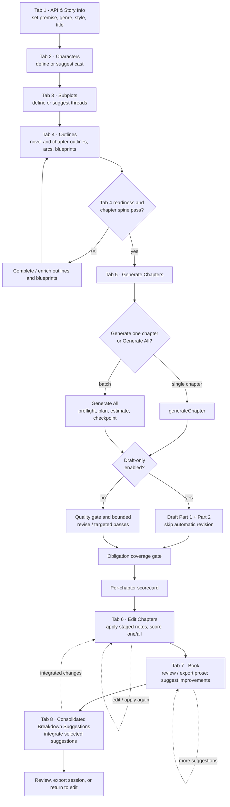

# NovelWriter architecture

NovelWriter is a single-page application in `NovelWriter.html`. The UI, shared
book state, workflow logic, and AI gateway are in that file; session files and
IndexedDB checkpoints provide the explicit persistence paths. This describes
the code in the current checkout, not an idealized future workflow.

## State and persistence

- **In memory:** `novelData` is the working book: story setup, characters,
  subplots, outlines and blueprints, chapter prose, continuity, quality and
  scorecard results, token usage, and batch progress. `requestLog` is the most
  recent request/response display. `collectData()` copies editable controls
  into `novelData`; chapter text is read from the Tab 5/6 editors
  (`NovelWriter.html:13023-13118`).
- **localStorage:** the app does not use `localStorage` to save or restore the
  book or API key. The key is held in the UI/in-memory state but is omitted from
  session exports and batch checkpoints. An old in-file testing comment about
  storing the key in localStorage is not the session persistence path
  (`NovelWriter.html:9325-9364`, `12126-12136`).
- **IndexedDB:** the `novelwriter` database / `checkpoints` store holds the
  latest resumable Generate All snapshot. It contains book data without the
  API key, and excludes the rejected draft that is retained only for session
  export (`NovelWriter.html:12087-12149`). A separate `novelwriter-timing` /
  `nwTimingStats` store holds aggregated per-call timing statistics
  (`NovelWriter.html:1223-1257`, `1288-1317`).
- **Session envelope:** `exportSession()` emits `schemaVersion: "1.0"`,
  `sourceTool`, `sourceVersion`, `exportedAt`, and `novelData` (including the
  request log), with timing data at the envelope's top-level `nwTiming` key
  (`NovelWriter.html:9325-9374`). `normalizeImportedSessionData()` accepts
  this envelope and legacy envelopes/bare data; `applySessionDataToUI()` then
  restores controls and views (`NovelWriter.html:9381-9461`,
  `9463-9556`). Imported timing data is shown for reference, not merged into
  the persistent timing statistics (`NovelWriter.html:9579-9584`).

## End-to-end tabs

The numbered workflow below is the primary authoring path. Tabs 10 and 11 are
debug and prompt-management utilities, outside this eight-tab path.



`generateChapter()` generates two prose parts and then runs continuity,
quality/revision (unless draft-only), obligation coverage, and the chapter
scorecard (`NovelWriter.html:11554-11753`). Tab 6's staged improvement path
uses `applyStagedChapterImprovements()` and can run a bounded targeted pass
after the edit (`NovelWriter.html:7623-7705`). Tab 7 presents the assembled
book and suggestions; Tab 8 integrates breakdowns into chapter planning and
prose (`NovelWriter.html:8926-9034`).

`ensureQualityAfterGenerate()` runs the heuristic gate, then
`reviseChapterForQuality()` and `runTargetedQualityPass()` as needed; the
draft-only branch records that automatic passes were skipped
(`NovelWriter.html:7290-7334`, `7134-7218`, `7418-7554`). The growth guard
rejects excessive growth, shrink, or lost paragraph structure and restores the
previous prose (`NovelWriter.html:7242-7286`). `scoreObligationCoverage()`
checks chapter blueprint obligations; `nwWorkflowStage()` derives the
book's progress label from its outlines, prose, and scorecards
(`NovelWriter.html:5604-5644`, `11370-11414`).

## Generate All: one chapter

Generate All runs chapters serially. It drafts prose for existing outlines; it
does not generate outlines. Preflight checks Tab 4 readiness and an 80-word
outline floor before any provider call (`NovelWriter.html:12063-12085`).
Existing prose is skipped unless regeneration is selected
(`NovelWriter.html:12049-12060`).

```mermaid
sequenceDiagram
    actor Author
    participant Batch as nwBatchStart / nwBatchLoop
    participant Chapter as nwBatchRunChapter / generateChapter
    participant AI as callAI
    participant Quality as quality and scorecard
    participant IDB as IndexedDB checkpoints

    Author->>Batch: Generate All or Resume
    Note over Author,Batch: Concurrency: reject if another batch runs or a manual AI call is active; acquire this run's owner token.
    Batch->>Batch: collectData, preflight, plan, estimate, initialize run
    Batch->>IDB: checkpoint before chapter
    loop each planned chapter, in order
        Batch->>Chapter: generateChapter(n, {batch:true})
        Chapter->>AI: Part 1
        AI-->>Chapter: response and usage
        Chapter->>AI: Part 2
        AI-->>Chapter: response and usage
        opt automatic continuity audit enabled
            Chapter->>AI: audit (retry audit only on retryable failure)
            AI-->>Chapter: findings
        end
        alt draft-only enabled
            Chapter->>Chapter: ensureQualityAfterGenerate records skip; no automatic revise passes
        else normal generation
            Chapter->>Quality: ensureQualityAfterGenerate
            Quality->>AI: sequential gate-fail / targeted revise calls as needed
            AI-->>Quality: revised prose
            Quality->>Quality: guardChapterReviseGrowth restores rejected growth/shrink
        end
        Chapter->>Quality: obligation coverage, then score generated chapter
        opt AI beat check enabled
            Quality->>AI: scorecard beat check
            AI-->>Quality: beat evidence
        end
        Quality-->>Batch: chapter outcome and scorecard
        Batch->>Batch: add real usage (estimate only if no usage); record completion or stop reason
        Batch->>IDB: checkpoint after chapter
        alt cap reached before or after chapter
            Batch->>Batch: stop with budget reason; keep saved cap for Resume
        else next chapter remains
            Note over Batch,AI: Concurrency: the loop awaits each chapter; Part 1, Part 2, audit, and revisions are sequential.
        end
    end
    opt interrupted by reload
        IDB-->>Batch: active checkpoint found by nwBatchCheckForInterrupted
        Batch->>Batch: restore; remove in-flight chapter from completed; Resume regenerates it
    end
    Batch->>IDB: final inactive checkpoint
    Batch-->>Author: done, paused, stopped, or budget-stopped
```

At run start, `nwBatchStart()` establishes a run owner and resets transient
batch flags/logs; a resumed run keeps its saved completed chapters, cap, and
usage (`NovelWriter.html:12320-12445`). `nwBatchEstimate()` uses mean real
session usage or a conservative fallback; `nwBatchRefreshEstimate()` refreshes
the displayed estimate and cap (`NovelWriter.html:12015-12027`,
`12221-12247`). `nwBatchLoop()` writes before/after chapter checkpoints,
charges actual provider usage when present, applies the cap, and classifies
stops (`NovelWriter.html:12448-12566`). A run also stops if a checkpoint write
fails. `nwBatchCheckForInterrupted()` offers restore; the in-flight chapter is
not marked complete and Resume retries it (`NovelWriter.html:12570-12609`).
Parse/provider stops regenerate the stopped chapter; a coverage stop is
acknowledged and skipped on the next Resume.

## One AI call

`callAI()` is the shared provider gateway. It selects the xAI endpoint by
model, sends the request, records returned token usage, parses/normalizes the
response, and returns it to its caller (`NovelWriter.html:2897-2909`,
`2950-3017`, `3025-3148`). HTTP/network errors set the request log to failed.
In a batch, a model JSON parse marker is treated as a parse stop by
`nwBatchRunChapter()` (`NovelWriter.html:12252-12299`).

```mermaid
sequenceDiagram
    actor Caller
    participant Call as callAI
    participant HUD as active-call HUD
    participant API as xAI API
    participant Book as novelData / requestLog
    participant Score as chapter scorecard
    participant IDB as nwTimingStats

    Caller->>Call: messages, tab, options
    Note over Caller,Call: Concurrency: each call gets a monotonically increasing ID in nwActiveCalls; activeAICallCount gates batch start.
    Call->>Book: validate key/model; mark request pending
    Call->>HUD: nwCallStart; show operation and elapsed time
    Call->>API: POST chat/completions or responses
    alt response arrives before timeout
        API-->>Call: HTTP response
        Call->>Call: parse envelope, record usage, normalize model content
        Call->>Book: requestLog completed; return parsed result
        opt generated chapter proceeds through scoring
            Call-->>Score: chapter prose and usage
            Score->>Score: nwScoreChapterVsBlueprint / nwScoreAndStoreChapter
            Score->>Book: write chapterScorecards and lastBookScore
        end
    else timeout or user cancels
        Call->>API: AbortController.abort()
        Call->>Book: mark request failed; ignore any late response
    else HTTP, network, or parse error
        API-->>Call: error
        Call->>Book: mark request failed; reject to caller
    end
    Call->>HUD: nwCallEnd; decrement active count
    Call->>IDB: nwTimingRecordSettle upserts aggregate row
    Note over Call,IDB: Concurrency: timing rows are loaded before updating when needed; the current tab merges newly seen keys.
```

`nwScoreChapterVsBlueprint()` calculates heuristic dimensions and can make a
separate AI beat-check call; `nwWriteChapterScorecard()` stores the chapter
record in `novelData`. `nwScoreBook()` awaits each requested chapter in order
and updates the book summary (`NovelWriter.html:11064-11118`,
`11120-11150`, `11159-11199`). Timing persistence is independent: successful
calls update average/min/max while timeout, abort, and error counters are
tracked separately (`NovelWriter.html:1288-1317`).

## Run and call states

```mermaid
stateDiagram-v2
    [*] --> Idle
    Idle --> Running: start after preflight
    Running --> Stopping: pause requested / failure / cap reached
    Stopping --> Stopped: pause, gate, coverage, provider, parse, checkpoint
    Stopping --> BudgetStopped: real usage reaches cap
    Running --> Done: all planned chapters complete and checkpointed
    Running --> Interrupted: reload while active checkpoint exists
    Interrupted --> Resumed: restore; in-flight chapter becomes incomplete
    Resumed --> Running: Resume
    Stopped --> Resumed: Resume / retry
    BudgetStopped --> Resumed: raise cap or keep saved cap; Resume
    Done --> [*]
```

`nwBatchState` tracks active ownership, chapter-in-flight, pause requests, and
an interrupted checkpoint; `novelData.batchRun` retains run id, range, completed
chapters, cap, usage, and stop reason (`NovelWriter.html:11794-11797`,
`12320-12445`). `nwBatchIsResumable()` excludes completed runs and uses the
stop reason to plan the retry (`NovelWriter.html:12153-12170`).

```mermaid
stateDiagram-v2
    [*] --> Pending
    Pending --> Succeeded: HTTP response parsed and normalized
    Pending --> Failed: provider, network, or parse error
    Pending --> TimedOut: configured timeout aborts request
    Pending --> Cancelled: user aborts request
    TimedOut --> [*]: late response ignored; active count released
    Cancelled --> [*]: late response ignored; active count released
    Succeeded --> [*]: usage and timing settled
    Failed --> [*]: failed request log and timing settled
```



The call timeout defaults to 300 seconds and is configurable in Setup
(`NovelWriter.html:1083-1096`). The slow-step UI may continue waiting or cancel;
`callAI()` races the fetch with timeout/cancel and prevents an abandoned
response from recording usage or returning prose (`NovelWriter.html:2911-2926`,
`2964-3024`, `3150-3195`).

## Concurrency rules mapped to code

| Rule | Shared state | Enforced by (function, file:line on main) | Status |
|---|---|---|---|
| Single owner per shared state | Batch writes to `novelData`, batchRun, editors | `nwBatchStart()` run-owner token, `nwBatchIsLocked()`, `nwBatchApplyLock()` (`NovelWriter.html:12320-12445`, `12153-12191`) | GAP — the batch serializes its writers, but standalone AI actions can still overlap against shared `requestLog`/book state. |
| Per-call IDs | Active call HUD / call lifecycle | `nwCallStart()`, `nwCallEnd()`, `nwActiveCallSeq`, `nwActiveCalls` (`NovelWriter.html:1087-1148`) | OK |
| Per-run resets | Transient batch flags, logs, completion state | `nwBatchStart()` initializes new-run data and clears transient owner/pause/coverage/log state; resume preserves saved progress (`NovelWriter.html:12320-12445`) | OK |
| Merge-not-replace for persisted stats | In-memory timing aggregates hydrated from IndexedDB | `nwTimingLoadStats()` merges newly seen keys after load; `nwTimingRecordSettle()` updates and puts a keyed aggregate (`NovelWriter.html:1259-1284`, `1288-1317`) | GAP — separate tabs can update the same key from stale counts; IDB `put` is not a cross-tab read/merge transaction. |
| UI locked during a batch | Chapter controls, editors, import, scoring, and other writers | `nwBatchApplyLock()` disables the covered controls; guarded writers also check `nwBatchIsLocked()` (`NovelWriter.html:12153-12191`, `7556-7560`, `9559-9577`) | OK |

## PR #149 status discrepancy

The issue asks to describe PR #149's callAI timeout/AbortController, `nwTiming`,
and Score-all lock as “pending, not yet on main”. That status is stale for this
checkout: GitHub reports PR #149 merged into `main`, and the current source
contains these changes. They are documented above as current code, not as
pending. If the intended architecture baseline predates that merge, the
baseline must be specified before the pending-state requirement can be
accurately represented.

## Validation harness

`scripts/qcat_harness.mjs` opens the single-file app in Playwright, blocks
network by default, imports a session, optionally stubs `callAI`, and invokes
`nwScoreBook()` to produce scorecard/session artifacts. Live regeneration is
opt-in and requires `QCAT_LIVE_ACK=1` (`scripts/qcat_harness.mjs:84-156`,
`159-168`, `221-255`). Its scoring logic remains in `NovelWriter.html`.

## Data model and schema (design only)

Status: DESIGN for A1. Engineering owns it. Product needs come from Fiction's `NW_STORY_SCHEMA_NEEDS.md` (written against main `600b35d`). No code changes in this PR. Slot S1 implements it, with a Reviewer GO on the migration trigger. Line numbers are approximate. The function names are the contract.

### 1. Where the data lives
- Everything is a **NovelWriter-local extension inside `novelData`**, carried in the existing shared v1.0 envelope. There are **no `schema/` or `docs/architecture/book-tools-contract/` changes**, so Nonfiction's confirm is not triggered by this design.
- Promoting any entity (`world`, `characters[].voice/relationships`, a cross-tool `id` scheme) into the shared book schema is a **separate, later decision**. It would need Nonfiction's confirm and a Reviewer GO.
- Persistence is unchanged: in memory `novelData`, then the session export/import envelope plus localStorage autosave. IndexedDB holds only `nwTimingStats` (8b) and is never story data.

### 2. Entities and single owners
| Entity | Keys in `novelData` | Owner (only writer) | Read-only consumers |
|---|---|---|---|
| World | `setting`, `genre`, `world{version,locations[],rules[],concepts[]*,topicTags[]*,notes?}`, legacy `worldBible`/`world` (preserved, never rewritten) | User edits in Tabs 1-2 and the AI-suggest buttons, through one `nwWorldUpdate(patch)` helper (S1) | prompt binders (`digestWorldBible`), 4p plan build, 8d scorecard, Q5 |
| Plot | `storyArc`, `generalPlot`, outlines, `chapterOutlines[]`, `chapterArcs[]`, `chapterBlueprints[]`, `subplots[]` (strings), `subplotsMeta[]` (same index), `chapterFactChecks[]`, `factChecks` | User and AI-suggest in Tabs 1-5 | Generate All, 4p, 8d, Q1-Q3 |
| Character | `characters[]{id?,name,backstory,arc,role,goal,flaw,notes,obligations[],voice?,relationships[]?,explainerFor[]*}` | User and AI-suggest in Tab 2, through `normalizeCharacterItem` only | prompts, 4p `cast`, 8d voice/cast, Q5 |
| Writing plan | `chapterWritingPlans[n-1]` | slot 4p build/edit | 8d `planCoverage`, Generate All prompt |
| Chapter flags | `chapterFlags[n-1]{coverageFailed?,missing?,replay?,at}` | 6b (coverage/missing) and Q3 (replay), **merge keys only** | Tab 6, Resume, Q3 |
| Scorecards | `chapterScorecards[n-1]` (incl. advisory `planCoverage`, null `worldImmersion`) | 8d scorer | Tab 6, export |
| Continuity | `continuityTracker` | Q5 (final text only) | prompts. Character per-chapter state is read here, **never duplicated** on Character |

`*` marks fields reserved for Brian's world-beats talk (`[WAIT]`). S1 accepts and preserves them as optional and does nothing else with them.

### 3. Preservation rules (the #141 lesson)
1. **Absent stays absent.** Import, tab rebuild and save never write a default into a field the session didn't have. The only exception is the documented empty-array coercion for arrays main already coerces.
2. **Unknown keys survive.** The normalizer only adds or validates known keys and never rebuilds `novelData` from a whitelist.
3. **One normalizer per entity**, used by import, DOM rebuild and AI-suggest alike. S1 must route the Tab 2 rebuild (~L4042) through `normalizeCharacterItem` (~L2210) and extend that function to keep `role, goal, flaw, notes, obligations, id, voice, relationships, explainerFor`.
4. **Subplots:** `normalizeSubplotItem` (~L2227) keeps flattening to the string array for compatibility, but **first** copies object fields to `subplotsMeta[i]`.
5. **World:** `worldBible`/`world` are kept byte-for-byte. A string value is also mirrored into `world.notes` only when `world` is otherwise absent, and the original key is left untouched.
6. `normalizeImportedSessionData` (~L9381) adds explicit handling for `world`, `worldBible`, `subplotsMeta`, `chapterFlags`, `chapterWritingPlans` and `nwSchemaVersion`: it validates type, keeps absent as absent, and keeps the wrong type as-is with a console warning, never dropping it.

### 4. Versioning and migration
- New `novelData.nwSchemaVersion` (integer). **Absent means legacy (0).** S1 sets it to `1`.
- `nwMigrateSession(nd)` runs once after `normalizeImportedSessionData` and before `applySessionDataToUI` (~L9464). It is pure (no DOM, no network, **no AI calls**), **additive**, and **idempotent**: `migrate(migrate(x))` deep-equals `migrate(x)`. It never deletes or renames a key. A version newer than the app knows is loaded read-through, unchanged, with a warning.
- v0 to v1 steps: stamp a version, copy subplot objects to `subplotsMeta`, mirror a string `worldBible` into `world.notes`, assign `characters[].id` (a stable slug of the name plus a de-dup suffix) only where it's missing, and leave every `[WAIT]` field untouched.
- Export always writes the current `nwSchemaVersion`. Older app builds ignore the extra keys through the existing spread.
- **S1 fixtures** (N6): a pre-6b session with no `chapterFlags`; a string `worldBible`; characters with `obligations/goal/flaw`; object subplots; a partial `chapterWritingPlans`; and a v1 session (to prove idempotence). Each must round-trip deep-equal except for the documented added keys. A mutation that drops any one field must fail the smoke.

### 5. Write-concurrency rules
| Rule | Applies to | Enforcement (S1 or existing) |
|---|---|---|
| Single writer per entity | §2 table | owner helpers; other code reads only |
| Story entities locked during a batch | World, Plot, Character edits and AI-suggest | `nwBatchIsLocked()` (~L12154) plus `nwBatchApplyLock` list. S1 adds any new World/Character controls to that list |
| Per-chapter records merge, never replace | `chapterFlags`, `chapterWritingPlans`, `chapterScorecards` | write `Object.assign({}, existing, patch)` keyed by chapter index. Q3 and 6b share `chapterFlags[n-1]` |
| Await load before write | IndexedDB `nwTimingStats` | existing: `nwTimingLoadStats()` (~L1259) and the record path (8b) |
| Per-call / per-run identity | AI calls, Generate All runs | existing: per-call `nwActiveCalls` Map (8b); per-run reset of batch state |
| Migration runs once, before UI | import path | `nwMigrateSession` between normalize and apply (S1) |

### 6. Gaps on main that S1 must close
1. `worldBible`/`world` aren't in the `novelData` defaults (~L732) or the import normalizer, and only survive through the spread.
2. The Tab 2 character DOM rebuild (~L4042) drops `obligations`, `goal` and `flaw`.
3. `normalizeCharacterItem` (~L2210) keeps only `name, backstory, arc, obligations`.
4. `normalizeSubplotItem` (~L2227) flattens objects to strings with no copy.

All four are the same class of data loss as #141. S1 closes them before Q1-Q3 and 4p build on the schema.
